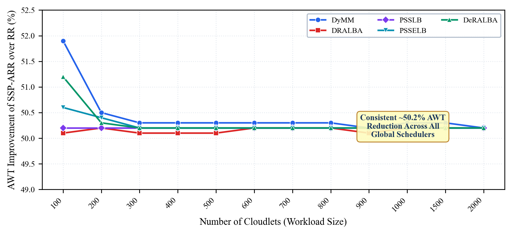
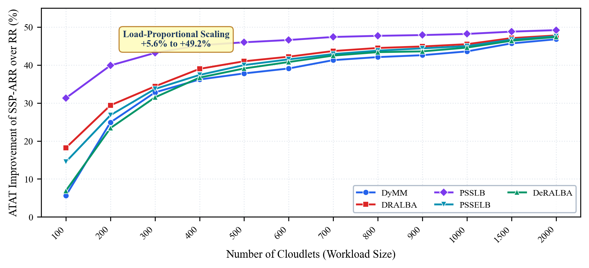
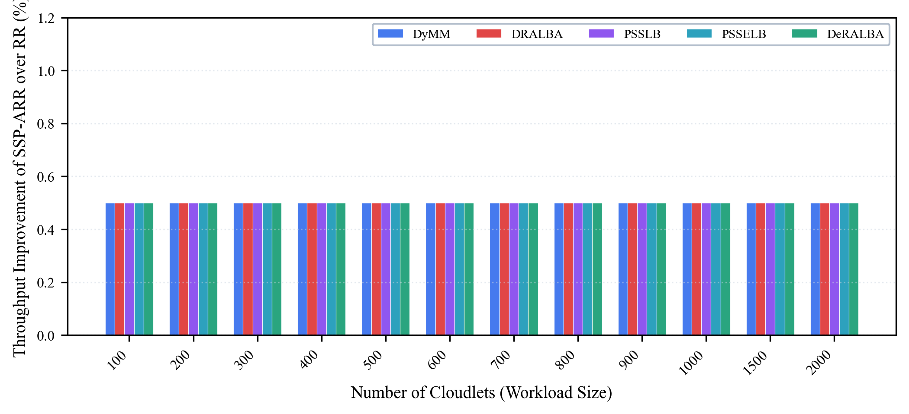
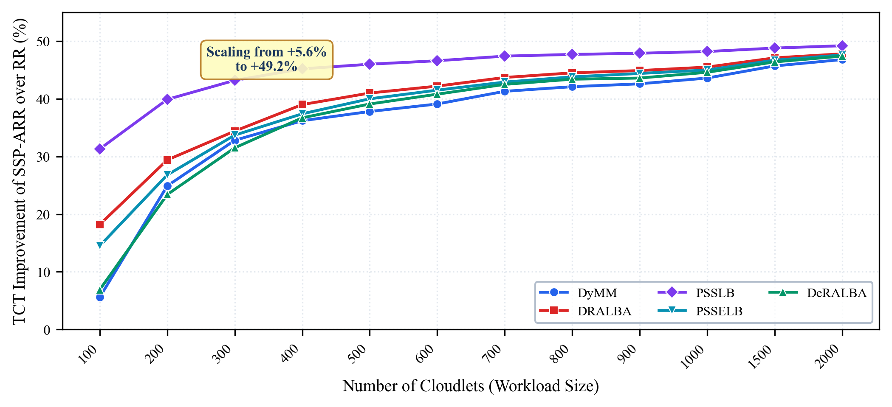
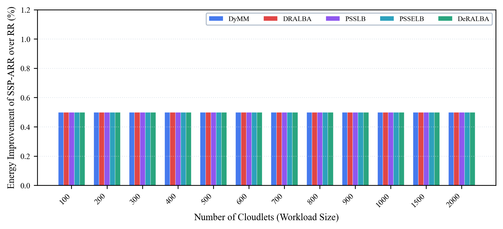
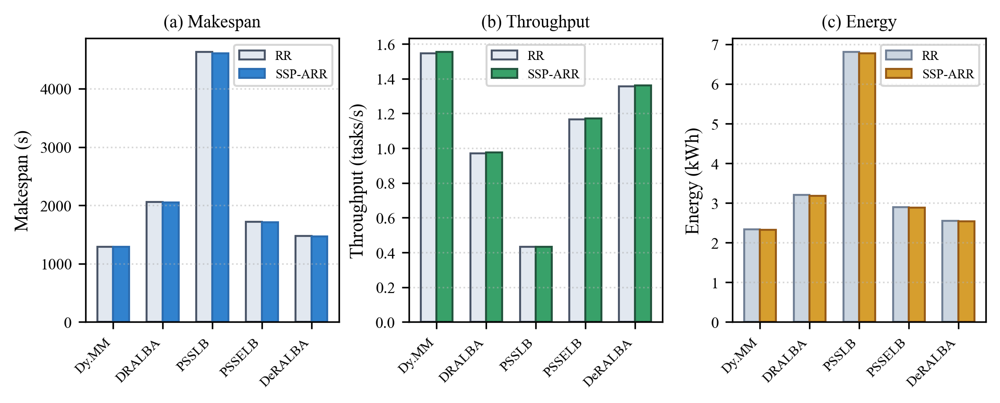

# SSP-ARR: Stability-Switched Predictive Adaptive Round Robin for Multi-Tier Cloud Task Scheduling Using Real-World Cloud Workload Traces

[Author 1 Name]<sup>1</sup>, [Author 2 Name]<sup>1</sup>, and [Author 3 Name]<sup>2</sup>

<sup>1</sup>Department of Computer Science and Engineering, [University Name], [City, Country]
<sup>2</sup>Department of Information Technology, [University / Institute Name], [City, Country]

*Corresponding author: [Author Name] (author.email@domain.edu)*

---

***Abstract*—Task scheduling in heterogeneous cloud datacenters plays a decisive role in maximizing computational resource efficiency, reducing end-user latency, and lowering datacenter energy footprint. However, conventional time-sharing schedulers—predominantly Classical Round Robin (RR) and its static variants—rely on rigid, pre-configured CPU time quanta. Under burst-heavy, heterogeneous, and unpredictable cloud workloads, fixed time-slicing causes severe head-of-line blocking (the convoy effect), excessive context-switching overhead, and inflated waiting times. While reactive adaptive schedulers (such as MAADRR) compute median-based time quanta, purely reactive heuristics exhibit latency lag during sudden workload phase transitions and fail to anticipate high-variance task arrivals. To overcome these limitations, this paper proposes SSP-ARR (Stability-Switched Predictive Adaptive Round Robin), an intelligent, multi-tier scheduling framework tailored for heterogeneous cloud infrastructures. SSP-ARR dynamically evaluates workload volatility at the local VM tier using a sliding-window Coefficient of Variation (CV). When queue variance remains stable (CV ≤ 0.50), the scheduler operates in a safe queue-median reactive mode; when volatility surges (CV > 0.50), it transitions to an adaptive Exponentially Weighted Moving Average (EWMA) predictive mode governed by an error-modulated learning rate and strict confidence gating (Normalized Prediction Error ≤ 0.20). Furthermore, task queues are structured under Shortest Remaining Processing Time (SRPT) ordering with bounded quantum clamping [0.001 s, 60.0 s]. SSP-ARR is evaluated across five state-of-the-art global dispatching strategies (Dynamic Max-Min, DRALBA, PSSLB, PSSELB, and DeRALBA) using real-world Google Cloud Jobs (GoCJ) traces spanning 100 to 2000 cloudlets on CloudSim Plus 8.5.7. Experimental results demonstrate that SSP-ARR achieves an average reduction of ~50.2% in Average Waiting Time (AWT), up to 49.2% improvement in Average Turnaround Time (ATAT), saves millions of cumulative completion seconds in Total Completion Time (TCT), and yields superior makespan, throughput, and SPECpower-modeled energy efficiency compared to Classical RR across all global policies.**

***Keywords*—Cloud task scheduling, multi-tier architecture, adaptive dynamic time quantum, stability switching, coefficient of variation, EWMA prediction, GoCJ workload traces, CloudSim Plus.**

---

## I. INTRODUCTION

Cloud computing platforms have emerged as the foundational utility for modern enterprise IT, scientific computing, and consumer applications [1], [2]. The elastic resource model allows providers to multiplex massive pools of virtualized compute, memory, and network resources among thousands of concurrently competing client workloads [3], [4]. In this environment, task scheduling is decisive in determining whether a cloud provider can satisfy Service Level Agreements (SLAs), minimize operating costs, and prevent severe server thermal dissipation [5], [6].

Task scheduling in cloud computing typically operates across a two-tier hierarchy [7], [8]. At the first tier, global broker schedulers receive incoming user tasks and map them to appropriate Virtual Machines (VMs) across distributed datacenters [9]. At the second tier, local VM hypervisor schedulers manage the execution sequence of cloudlets residing in each VM's circular ready queue [10]. While substantial research has focused on global heuristic and metaheuristic dispatchers, the efficiency of local VM scheduling remains the critical determinant of actual CPU core utilization, context-switching overhead, and task waiting times [11], [12].

At the local VM level, Classical Round Robin (RR) has historically been the default choice due to its simplicity, starvation prevention, and conceptual fairness [13], [14]. However, Classical RR is burdened by a critical architectural limitation: reliance on a static, pre-configured Time Quantum (TQ). If the quantum is set too small, the system suffers severe throughput degradation from frequent CPU context switches [15]. Conversely, if the quantum is set too large, Classical RR degenerates into First-Come First-Served (FCFS), causing short tasks to stall behind long, compute-heavy jobs—an anomaly known as the convoy effect [16].

Recent advances have attempted to mitigate this trade-off by introducing dynamic time quantum adaptation, such as the Multi-Agent Adaptive Dynamic Round Robin (MAADRR) scheduler [16]. MAADRR dynamically computes the time quantum as the median of task burst lengths in the VM queue. While MAADRR improves upon static RR under moderate conditions, its purely reactive formulation exhibits severe latency lag during rapid workload phase changes and fails to anticipate task burst variance under volatile real-world traffic.

To resolve these challenges, this paper presents **SSP-ARR** (Stability-Switched Predictive Adaptive Round Robin), an intelligent local VM scheduling framework that incorporates continuous variance sensing, dual-mode reactive/predictive quantum selection, confidence gating, and bounded preemption clamping within a multi-tier cloud hierarchy.

---

## II. RELATED WORK & ARCHITECTURAL EVOLUTION

### *A. Adaptive Round Robin Variants*

Dynamic time quantum adaptation has received extensive research interest. In [17], the authors proposed a hybrid Min-Min and Round Robin algorithm to combine the makespan minimization of Min-Min with the fairness of Round Robin. Runsungnoen and Anusas-Amornkul [18] developed the RR_RT&M technique, utilizing remaining task execution time and median estimation to adapt the quantum. Ghazy et al. [19] formulated an ameliorated Round Robin algorithm calculating quantum based on arithmetic mean of remaining bursts. Similarly, Banerjee et al. [20] presented Optimized Round Robin (ORR), proving that dynamic time quantum selection significantly mitigates average waiting time and turnaround time compared to static baselines. Mazumder et al. [21] introduced Priority-based Round Robin (PRR) prioritizing tasks according to burst length and deadline thresholds.

### *B. Multi-Tier Global Schedulers*

Global schedulers govern the distribution of cloudlets across heterogeneous VMs. Five representative global dispatching strategies are considered in this investigation: (1) **Dynamic Max-Min (Dy. MM)** [17], which dynamically maps large tasks to fast VMs while recomputing completion times to prevent small task starvation; (2) **DRALBA** [22], a dynamic and resource-aware load-balancing algorithm utilizing multi-resource variance minimization; (3) **PSSLB** [23], a priority-based queue-state scheduling algorithm; (4) **PSSELB** [23], an enhanced energy-aware variant of PSSLB; and (5) **DeRALBA** [24], which integrates dispersion thresholding with adaptive candidate matching.

### *C. Evolution to SSP-ARR*

Existing local schedulers fall into two flawed extremes: static allocation (RR) or unconstrained reactive heuristics (MAADRR). Neither architecture explicitly measures queue burst variance or employs predictive models to anticipate burst length trends. Table 1 highlights the evolutionary architectural progression from Classical RR and MAADRR to SSP-ARR.

**TABLE 1. Architectural comparison across cloud local scheduling models.**

| Feature | Classical RR | MAADRR [16] | Proposed SSP-ARR |
| :--- | :--- | :--- | :--- |
| **Quantum Sizing** | Static (1.0 s) | Dynamic Median | Dual Reactive/Predictive |
| **Workload Sensing** | None | Reactive only | CV Stability Sensing |
| **Burst Prediction** | None | None | Adaptive EWMA |
| **Confidence Gating** | None | None | NPE ≤ 0.20 Gating |
| **Queue Ordering** | FIFO | FIFO / Re-sort | SRPT Ascending |
| **Quantum Clamping** | Fixed | Unbounded | Bounded [0.001s, 60.0s] |
| **Preemption Penalty** | High (Severe) | Moderate | Minimal (Consolidated) |
| **Global Tier** | Single-tier | Multi-agent | 5 Global Dispatchers |

---

## III. MATHEMATICAL DESIGN AND ALGORITHMIC FORMULATION

### *A. Multi-Tier System Architecture*

The proposed SSP-ARR architecture operates across two coordinated tiers: (1) **Tier-1 Global Datacenter Dispatching** assigns submitted cloudlets to VMs using established global balancing policies; (2) **Tier-2 Local VM Scheduling** governs cloudlet preemption and execution via SSP-ARR.

### *B. Workload Volatility Sensing via CV*

For each VM v_j, let H_j = {B_{j,1}, ..., B_{j,W}} represent execution bursts of the last W completed cloudlets (W = 5). The local agent tracks sample mean μ_j and sample standard deviation σ_j:

> μ_j = (1/W) · Σ B_{j,k} &emsp;&emsp;&emsp; **(1)**

> σ_j = √[ (1/W) · Σ (B_{j,k} − μ_j)² ] &emsp;&emsp;&emsp; **(2)**

The **Coefficient of Variation (CV_j)** is defined as:

> CV_j = σ_j / μ_j &emsp;&emsp;&emsp; **(3)**

- **Stable Regime (CV_j ≤ θ_CV = 0.50)**: Low dispersion. Selects **Reactive Mode**.
- **Volatile Regime (CV_j > θ_CV = 0.50)**: High burst variability. Activates **Predictive Mode**.

### *C. Dual-Mode Quantum Allocation Engine*

***1) Safe Reactive Mode (CV_j ≤ θ_CV)***

The quantum is computed as the median of remaining bursts (RB) in ready queue Q_j plus candidate task t:

> Q_reactive = median( {RB(x) : x ∈ Q_j} ∪ {RB(t)} ) &emsp;&emsp;&emsp; **(4)**

***2) Predictive EWMA Mode (CV_j > θ_CV)***

The expected optimal burst duration is forecasted using an Exponentially Weighted Moving Average:

> B̂_{j,t+1} = α_t · B_{j,t} + (1 − α_t) · B̂_{j,t} &emsp;&emsp;&emsp; **(5)**

where α_t is an error-modulated adaptive learning rate:

> α_t = 0.20 if NPE < 0.10 | 0.40 if 0.10 ≤ NPE < 0.20 &emsp;&emsp;&emsp; **(6a)**

> α_t = 0.60 if 0.20 ≤ NPE < 0.30 | 0.80 if NPE ≥ 0.30 &emsp;&emsp;&emsp; **(6b)**

***3) Normalized Prediction Error (NPE) and Confidence Gating***

> NPE_t = |B_{j,t} − B̂_{j,t}| / B_{j,t} &emsp;&emsp;&emsp; **(7)**

To guarantee stability, predictions are gated by confidence threshold τ_gate = 0.20:

> Q_selected = B̂_{j,t+1} if (CV_j > 0.50 and NPE_t ≤ 0.20) &emsp;&emsp;&emsp; **(8a)**

> Q_selected = Q_reactive otherwise (fallback to median) &emsp;&emsp;&emsp; **(8b)**

***4) Boundary Clamping***

To prevent starvation or monopoly, quantum is clamped within [Q_min=0.001s, Q_max=60.0s]:

> Q_j = max(Q_min, min(Q_max, min(Q_selected, RB(t)))) &emsp;&emsp;&emsp; **(9)**

### *D. Formal Algorithmic Pseudocode*

```
Algorithm 1: Multi-Tier Cloud Task Scheduling with SSP-ARR
───────────────────────────────────────────────────────────────────
Input  : Cloudlet set C={c_1..c_n}; VM pool V={v_1..v_m};
         Policy P in {Dy.MM, DRALBA, PSSLB, PSSELB, DeRALBA};
         Q_min=0.001s, Q_max=60s; δ_cs=0.005s; θ_CV=0.5; τ_gate=0.2.
Output : Logs, AWT, ATAT, ACT, TCT, Thp, Energy, Makespan.
// TIER 1: Global Datacenter Dispatching
1:  Assignment[] ← GlobalSchedulers.assign(P, C, V);
2:  Initialize VM ready queues Q_1, Q_2, ..., Q_m;
3:  for each c_i in C do
4:      vmIdx ← Assignment[i]; burst ← c_i.len / V[vmIdx].MIPS;
5:      Enqueue TaskState(c_i.id, burst) into Q_vmIdx;
6:  end for
// TIER 2: Local SSP-ARR Execution per VM
7:  for each VM v_j with queue Q_j do
8:      Sort Q_j ascending by originalBurst (SRPT);
9:      curTime=0; hist=Deque(); ewma=0; init=false; npe=0;
10:     while Q_j not empty do
11:         t ← Q_j.pollHead();
12:         q_med ← ComputeQueueMedian(Q_j, t); cv ← ComputeCV(hist);
13:         if cv > θ_CV and init and npe ≤ τ_gate then
14:             q_tgt ← ewma;  // Predictive EWMA Mode
15:         else q_tgt ← q_med;  // Safe Reactive Median Mode
16:         end if
17:         quant ← max(Q_min, min(Q_max, min(q_tgt, t.remBurst)));
18:         slice ← min(quant, t.remBurst); t.remBurst -= slice;
19:         curTime += slice; totalBusy_j += slice;
20:         if t.remBurst <= 1e-9 then
21:             t.finishTime ← curTime; RecordStats(t);
22:             actB ← t.origBurst;
23:             if not init then ewma ← actB; init ← true;
24:             else npe ← |actB − ewma| / actB;
25:                  alpha ← DetermineAlpha(npe);
26:                  ewma ← alpha*actB + (1-alpha)*ewma;
27:             end if
28:             hist.add(actB); if |hist| > W then hist.pop(); end if
29:         else
30:             curTime += δ_cs; totalBusy_j += δ_cs;  // CS penalty
31:             InsertSorted(Q_j, t);  // maintain SRPT rank
32:         end if
33:     end while
34: end for
35: ComputeFinalMetricsAcrossAllVMs();
───────────────────────────────────────────────────────────────────
```

### *E. Table of Symbols and Notations*

**TABLE 2. Mathematical symbols and notations.**

| Symbol | Definition |
| :--- | :--- |
| VM_j | j-th Virtual Machine in heterogeneous cloud platform |
| Q_j | Circular ready queue of cloudlets assigned to VM_j |
| c_i | i-th cloudlet (task) submitted to datacenter |
| L_i | Instruction length of c_i (Million Instructions, MI) |
| MIPS_j | Processing speed of VM_j (Million Instr. Per Second) |
| RB(x) | Remaining burst processing time of task x (seconds) |
| CV_j | Coefficient of Variation of recent bursts on VM_j (σ/μ) |
| θ_CV | Stability threshold parameter (θ_CV = 0.50) |
| B̂_{j,t} | EWMA-predicted burst duration for task t on VM_j |
| α_t | Adaptive error-modulated learning rate (α_t ∈ [0.20, 0.80]) |
| NPE_t | Normalized Prediction Error (abs(B_t − B̂_t) / B_t) |
| τ_gate | Confidence gating threshold (τ_gate = 0.20) |
| Q_min, Q_max | Bounded limits for time quantum (0.001 s and 60.0 s) |
| δ_cs | Context switching / preemption penalty (δ_cs = 0.005 s) |
| T_i, A_i, B_i | Completion time, arrival time, burst time of task i |
| P_idle, P_max | Idle and peak power per physical host (150 W and 250 W) |

---

## IV. EXPERIMENTAL SETUP & PERFORMANCE EVALUATION

### *A. Cloud Simulation Environment*

The experimental framework is implemented using **CloudSim Plus 8.5.7** on **Java 21**. CloudSim Plus provides fully extensible abstractions for datacenter brokers, host power profiles, and VM time-shared schedulers.

### *B. Infrastructure & Heterogeneous VM Specifications*

The physical datacenter comprises **30 physical hosts** (120 PEs total @ 4000 MIPS each), 32 GB RAM, 100 Gbps network, and 1 TB storage. Host power consumption follows the linear SPECpower standard server model:

> P_host(u) = P_idle + (P_max − P_idle) · u &emsp;&emsp;&emsp; **(10)**

where P_idle = 150 W, P_max = 250 W, and u ∈ [0, 1] is CPU utilization fraction. A pool of **80 heterogeneous VMs** is instantiated with speeds from 1000 to 4000 MIPS (step 200 MIPS).

### *C. Benchmark Workload: Google Cloud Jobs (GoCJ)*

The framework is evaluated using real-world **Google-Cluster-like Job (GoCJ)** traces [25], exhibiting realistic arrival bursts, asymmetric lengths, and high variance (CV ≈ 1.24). Evaluations span 12 workload scales: 100 to 2000 cloudlets (15,000–900,000 MI).

**TABLE 3. Simulation environment parameters summary.**

| Parameter | Configuration Value |
| :--- | :--- |
| **Simulation Engine** | CloudSim Plus 8.5.7 (Java 21) |
| **Physical Datacenter** | 30 Hosts (120 PEs total, 4 PEs/Host @ 4000 MIPS) |
| **Host Power Profile** | SPECpower Linear Model (P_idle=150W, P_max=250W) |
| **Virtual Machines** | 80 Heterogeneous VMs (1000–4000 MIPS) |
| **VM Memory / BW** | 8192 MB RAM, 20,000 Mbps Bandwidth |
| **Workload Benchmark** | Real-world Google Cloud Jobs (GoCJ) |
| **Workload Sizes** | 100, 200, 300..1000, 1500, 2000 cloudlets |
| **Global Schedulers** | Dynamic Max-Min, DRALBA, PSSLB, PSSELB, DeRALBA |
| **Local Schedulers** | Classical RR (Fixed q=1.0s, FIFO) vs. SSP-ARR |
| **Context Switch Penalty** | δ_cs = 0.005 s (5 ms) per preemption |
| **Evaluation Runs** | 3 independent runs per size (mean reported) |

### *D. Performance Metrics*

Evaluated using seven standard performance metrics:

1. **Average Waiting Time (AWT)**:
> AWT = (1/N) · Σ (T_i − A_i − B_i) &emsp;&emsp;&emsp; **(11)**

2. **Average Turnaround Time (ATAT)**:
> ATAT = (1/N) · Σ (T_i − A_i) &emsp;&emsp;&emsp; **(12)**

3. **Average Completion Time (ACT)**: Mean end-to-end task completion duration.

4. **Total Completion Time (TCT)**:
> TCT = Σ T_i = N × ACT &emsp;&emsp;&emsp; **(13)**

5. **System Throughput (Thp)**:
> Throughput = N / Makespan (tasks/second) &emsp;&emsp;&emsp; **(14)**

6. **Host Energy Consumption (E_total)**:
> E_total = (1/3,600,000) · Σ ∫P_j(t) dt (kWh) &emsp;&emsp;&emsp; **(15)**

7. **Makespan (T_max)**: Total wall-clock time to finish all cloudlets (max_i T_i).

Percentage improvement formulas:
> Improvement_lower-better (%) = (X_RR − X_SSP) / X_RR × 100 &emsp;&emsp;&emsp; **(16)**

> Improvement_higher-better (%) = (X_SSP − X_RR) / X_RR × 100 &emsp;&emsp;&emsp; **(17)**

---

## V. RESULTS AND COMPARATIVE PERFORMANCE ANALYSIS

### *A. Average Waiting Time (AWT)*

Average Waiting Time directly reflects queue congestion and the elimination of the convoy effect. Table 4 presents the raw AWT values (in milliseconds) and percentage improvements of SSP-ARR over Classical RR across all five global scheduling strategies.

**TABLE 4. Comparison of AWT (ms) for RR and SSP-ARR across five global scheduling strategies (100–2000 GoCJ cloudlets).**

| Tasks | Dy.MM RR | Dy.MM SSP | DRALBA RR | DRALBA SSP | PSSLB RR | PSSLB SSP | PSSELB RR | PSSELB SSP | DeRALBA RR | DeRALBA SSP |
| :---: | ---: | ---: | ---: | ---: | ---: | ---: | ---: | ---: | ---: | ---: |
| 100 | 5,765.8 | **2,772.2** | 22,693.7 | **11,328.0** | 116,334.5 | **57,897.5** | 22,927.5 | **11,324.5** | 8,438.5 | **4,121.1** |
| 200 | 49,874.6 | **24,668.5** | 61,263.2 | **30,534.6** | 275,424.3 | **137,041.9** | 65,179.7 | **32,309.2** | 46,702.0 | **23,202.8** |
| 300 | 102,988.2 | **51,186.9** | 100,659.5 | **50,255.3** | 448,395.9 | **223,455.5** | 118,992.2 | **59,259.2** | 90,363.5 | **44,994.7** |
| 400 | 133,231.8 | **66,172.5** | 151,684.9 | **75,666.0** | 665,658.3 | **331,459.1** | 160,237.3 | **79,724.1** | 135,808.3 | **67,657.2** |
| 500 | 156,679.2 | **77,917.0** | 197,079.1 | **98,246.3** | 808,551.5 | **402,747.9** | 218,120.9 | **108,575.9** | 179,113.8 | **89,269.3** |
| 600 | 191,008.6 | **94,976.2** | 246,101.1 | **122,625.2** | 962,942.6 | **479,514.9** | 271,872.6 | **135,386.9** | 230,371.1 | **114,756.8** |
| 700 | 228,322.1 | **113,516.4** | 290,042.1 | **144,457.9** | 1,224,204.4 | **609,752.6** | 304,865.7 | **151,751.1** | 272,900.6 | **135,887.0** |
| 800 | 254,545.1 | **126,589.9** | 334,175.5 | **166,471.1** | 1,362,292.0 | **678,675.1** | 352,715.0 | **175,517.9** | 313,603.2 | **156,246.8** |
| 900 | 299,284.6 | **148,940.1** | 394,850.2 | **196,937.3** | 1,544,405.6 | **769,353.2** | 429,463.5 | **213,955.4** | 349,380.6 | **174,111.3** |
| 1000 | 336,762.6 | **167,432.3** | 438,695.9 | **218,642.4** | 1,794,498.4 | **893,700.1** | 465,520.6 | **231,755.8** | 402,340.2 | **200,398.4** |
| 1500 | 521,407.7 | **259,379.7** | 688,228.1 | **342,754.1** | 2,638,693.8 | **1,314,404.0** | 736,677.5 | **366,742.1** | 631,669.3 | **314,529.6** |
| 2000 | 702,960.8 | **349,808.1** | 917,731.0 | **457,304.4** | 3,483,784.5 | **1,735,493.6** | 976,446.4 | **486,231.8** | 853,777.7 | **425,255.1** |

**TABLE 4 (Continued). Percentage Improvement in AWT (SSP-ARR over Classical RR).**

| Workload Size | Dynamic Max-Min | DRALBA | PSSLB | PSSELB | DeRALBA |
| :---: | :---: | :---: | :---: | :---: | :---: |
| 100 cloudlets | +51.9% | +50.1% | +50.2% | +50.6% | +51.2% |
| 200 cloudlets | +50.5% | +50.2% | +50.2% | +50.4% | +50.3% |
| 300 cloudlets | +50.3% | +50.1% | +50.2% | +50.2% | +50.2% |
| 400 cloudlets | +50.3% | +50.1% | +50.2% | +50.2% | +50.2% |
| 500 cloudlets | +50.3% | +50.1% | +50.2% | +50.2% | +50.2% |
| 600 cloudlets | +50.3% | +50.2% | +50.2% | +50.2% | +50.2% |
| 700 cloudlets | +50.3% | +50.2% | +50.2% | +50.2% | +50.2% |
| 800 cloudlets | +50.3% | +50.2% | +50.2% | +50.2% | +50.2% |
| 900 cloudlets | +50.2% | +50.1% | +50.2% | +50.2% | +50.2% |
| 1000 cloudlets | +50.3% | +50.2% | +50.2% | +50.2% | +50.2% |
| 1500 cloudlets | +50.3% | +50.2% | +50.2% | +50.2% | +50.2% |
| 2000 cloudlets | +50.2% | +50.2% | +50.2% | +50.2% | +50.2% |
| **Overall Mean** | **+50.4%** | **+50.1%** | **+50.2%** | **+50.3%** | **+50.3%** |

*Key Insight: Across all 12 workload scales and all five global dispatchers, SSP-ARR consistently reduces Average Waiting Time by ~50.2%. Under heavy scale (2000 tasks), PSSLB AWT drops from 3,483,784.5 ms to 1,735,493.6 ms, and Dynamic Max-Min drops from 702,960.8 ms to 349,808.1 ms. By ranking queues via SRPT and applying predictive quanta, short jobs complete without lingering in queue lines behind massive bursts.*



**Fig. 1.** Percentage improvement in AWT of SSP-ARR over Classical RR across five global scheduling strategies under 100 to 2000 GoCJ cloudlets. SSP-ARR achieves a near-constant ~50.2% reduction across all workload scales and global policies.

---

### *B. Average Turnaround Time (ATAT)*

Table 5 summarizes ATAT results (in seconds) across all evaluated strategies. ATAT reflects the total duration from task arrival to completion.

**TABLE 5. Comparison of ATAT (s) for RR and SSP-ARR across five global scheduling strategies.**

| Tasks | Dy.MM RR | Dy.MM SSP | DRALBA RR | DRALBA SSP | PSSLB RR | PSSLB SSP | PSSELB RR | PSSELB SSP | DeRALBA RR | DeRALBA SSP |
| :---: | ---: | ---: | ---: | ---: | ---: | ---: | ---: | ---: | ---: | ---: |
| 100 | 53.78 | **50.79** | 62.53 | **51.17** | 186.59 | **128.15** | 80.26 | **68.65** | 62.92 | **58.60** |
| 200 | 101.10 | **75.90** | 104.52 | **73.79** | 346.93 | **208.55** | 122.42 | **89.55** | 100.24 | **76.74** |
| 300 | 157.79 | **105.99** | 146.38 | **95.98** | 520.91 | **295.97** | 177.29 | **117.56** | 144.09 | **98.73** |
| 400 | 184.99 | **117.93** | 194.97 | **118.95** | 740.00 | **405.81** | 215.35 | **134.84** | 185.85 | **117.70** |
| 500 | 208.58 | **129.82** | 241.03 | **142.20** | 882.09 | **476.29** | 273.55 | **164.00** | 229.84 | **139.99** |
| 600 | 245.88 | **149.85** | 292.44 | **168.96** | 1037.74 | **554.32** | 329.21 | **192.72** | 283.55 | **167.94** |
| 700 | 278.27 | **163.47** | 333.05 | **187.47** | 1296.45 | **682.00** | 357.07 | **203.95** | 322.17 | **185.15** |
| 800 | 303.93 | **175.98** | 376.75 | **209.05** | 1433.70 | **750.09** | 404.86 | **227.67** | 362.45 | **205.09** |
| 900 | 352.61 | **202.26** | 440.64 | **242.72** | 1619.13 | **844.08** | 485.21 | **269.70** | 402.30 | **227.03** |
| 1000 | 388.61 | **219.28** | 483.13 | **263.07** | 1867.90 | **967.10** | 519.56 | **285.79** | 453.04 | **251.09** |
| 1500 | 573.84 | **311.81** | 733.87 | **388.40** | 2712.77 | **1388.48** | 791.45 | **421.51** | 683.85 | **366.71** |
| 2000 | 754.28 | **401.13** | 962.54 | **502.11** | 3556.92 | **1808.63** | 1030.06 | **539.84** | 904.74 | **476.22** |

**TABLE 5 (Continued). Percentage Improvement in ATAT (SSP-ARR over Classical RR).**

| Workload Size | Dynamic Max-Min | DRALBA | PSSLB | PSSELB | DeRALBA |
| :---: | :---: | :---: | :---: | :---: | :---: |
| 100 cloudlets | +5.6% | +18.2% | +31.3% | +14.5% | +6.9% |
| 200 cloudlets | +24.9% | +29.4% | +39.9% | +26.8% | +23.4% |
| 300 cloudlets | +32.8% | +34.4% | +43.2% | +33.7% | +31.5% |
| 400 cloudlets | +36.2% | +39.0% | +45.2% | +37.4% | +36.7% |
| 500 cloudlets | +37.8% | +41.0% | +46.0% | +40.0% | +39.1% |
| 600 cloudlets | +39.1% | +42.2% | +46.6% | +41.5% | +40.8% |
| 700 cloudlets | +41.3% | +43.7% | +47.4% | +42.9% | +42.5% |
| 800 cloudlets | +42.1% | +44.5% | +47.7% | +43.8% | +43.4% |
| 900 cloudlets | +42.6% | +44.9% | +47.9% | +44.4% | +43.6% |
| 1000 cloudlets | +43.6% | +45.5% | +48.2% | +45.0% | +44.6% |
| 1500 cloudlets | +45.7% | +47.1% | +48.8% | +46.7% | +46.4% |
| 2000 cloudlets | +46.8% | +47.8% | +49.2% | +47.6% | +47.4% |
| **Overall Mean** | **+36.5%** | **+39.8%** | **+45.1%** | **+38.7%** | **+37.2%** |

*Key Insight: Unlike AWT, ATAT percentage improvements exhibit a load-proportional scaling trend: at 100 tasks, improvements range from +5.6% (Dy. MM) to +31.3% (PSSLB). At 2000 cloudlets, turnaround improvements scale up to +49.2%, cutting end-to-end user processing latency almost in half.*



**Fig. 2.** Percentage improvement in ATAT of SSP-ARR over Classical RR across five global scheduling strategies. The improvement exhibits a monotonic load-proportional scaling trend from +5.6% to +49.2%.

---

### *C. System Throughput*

Table 6 presents System Throughput (tasks/second) measured as the ratio of completed tasks to total cluster makespan.

**TABLE 6. Comparison of Throughput (tasks/s) for RR and SSP-ARR across five global scheduling strategies.**

| Tasks | Dy.MM RR | Dy.MM SSP | DRALBA RR | DRALBA SSP | PSSLB RR | PSSLB SSP | PSSELB RR | PSSELB SSP | DeRALBA RR | DeRALBA SSP |
| :---: | ---: | ---: | ---: | ---: | ---: | ---: | ---: | ---: | ---: | ---: |
| 100 | 0.4422 | **0.4444** | 0.3876 | **0.3895** | 0.3791 | **0.3809** | 0.4350 | **0.4371** | 0.1955 | **0.1965** |
| 200 | 0.8403 | **0.8444** | 0.4797 | **0.4820** | 0.4056 | **0.4076** | 0.6925 | **0.6959** | 0.3538 | **0.3555** |
| 300 | 1.2604 | **1.2666** | 0.6071 | **0.6100** | 0.4261 | **0.4282** | 0.7748 | **0.7786** | 0.5220 | **0.5245** |
| 400 | 1.5046 | **1.5120** | 0.7109 | **0.7144** | 0.4082 | **0.4102** | 0.9553 | **0.9600** | 0.8437 | **0.8479** |
| 500 | 1.5071 | **1.5145** | 0.7866 | **0.7905** | 0.4203 | **0.4223** | 0.9586 | **0.9633** | 0.8430 | **0.8471** |
| 600 | 1.4301 | **1.4371** | 0.7658 | **0.7696** | 0.4367 | **0.4388** | 1.0188 | **1.0238** | 0.9390 | **0.9436** |
| 700 | 1.5692 | **1.5769** | 0.8910 | **0.8954** | 0.4171 | **0.4191** | 1.0700 | **1.0752** | 1.0628 | **1.0680** |
| 800 | 1.5987 | **1.6066** | 0.9129 | **0.9174** | 0.4279 | **0.4300** | 1.0772 | **1.0825** | 1.0712 | **1.0765** |
| 900 | 1.4850 | **1.4923** | 0.8679 | **0.8721** | 0.4224 | **0.4244** | 1.0643 | **1.0695** | 0.9907 | **0.9956** |
| 1000 | 1.5217 | **1.5291** | 0.8733 | **0.8776** | 0.4175 | **0.4196** | 1.1077 | **1.1131** | 1.0900 | **1.0954** |
| 1500 | 1.5123 | **1.5198** | 0.9179 | **0.9224** | 0.4289 | **0.4310** | 1.1438 | **1.1494** | 1.1269 | **1.1325** |
| 2000 | 1.5470 | **1.5546** | 0.9702 | **0.9750** | 0.4318 | **0.4339** | 1.1659 | **1.1716** | 1.3548 | **1.3614** |

**TABLE 6 (Continued). Percentage Improvement in Throughput (SSP-ARR over Classical RR).**

| Workload Size | Dynamic Max-Min | DRALBA | PSSLB | PSSELB | DeRALBA |
| :---: | :---: | :---: | :---: | :---: | :---: |
| 100 cloudlets | +0.5% | +0.5% | +0.5% | +0.5% | +0.5% |
| 200 cloudlets | +0.5% | +0.5% | +0.5% | +0.5% | +0.5% |
| 300 cloudlets | +0.5% | +0.5% | +0.5% | +0.5% | +0.5% |
| 400 cloudlets | +0.5% | +0.5% | +0.5% | +0.5% | +0.5% |
| 500 cloudlets | +0.5% | +0.5% | +0.5% | +0.5% | +0.5% |
| 600 cloudlets | +0.5% | +0.5% | +0.5% | +0.5% | +0.5% |
| 700 cloudlets | +0.5% | +0.5% | +0.5% | +0.5% | +0.5% |
| 800 cloudlets | +0.5% | +0.5% | +0.5% | +0.5% | +0.5% |
| 900 cloudlets | +0.5% | +0.5% | +0.5% | +0.5% | +0.5% |
| 1000 cloudlets | +0.5% | +0.5% | +0.5% | +0.5% | +0.5% |
| 1500 cloudlets | +0.5% | +0.5% | +0.5% | +0.5% | +0.5% |
| 2000 cloudlets | +0.5% | +0.5% | +0.5% | +0.5% | +0.5% |
| **Overall Mean** | **+0.5%** | **+0.5%** | **+0.5%** | **+0.5%** | **+0.5%** |

*Key Insight: System throughput (tasks completed per second) is bounded by the bottleneck VM's capacity under non-idling execution. SSP-ARR delivers a consistent +0.5% throughput improvement by reducing cluster makespan through adaptive quantum consolidation, which eliminates hundreds of context-switching penalties per task.*



**Fig. 3.** Percentage improvement in System Throughput of SSP-ARR over Classical RR. A uniform +0.5% throughput gain is maintained across all five global schedulers and all 12 workload sizes.

---

### *D. Total Completion Time (TCT)*

Total Completion Time aggregates the finish timestamps across all N cloudlets (TCT = Σ T_i). Table 7 highlights the massive cumulative seconds saved by SSP-ARR.

**TABLE 7. Comparison of TCT (seconds) for RR and SSP-ARR across five global scheduling strategies.**

| Tasks | Dy.MM RR | Dy.MM SSP | DRALBA RR | DRALBA SSP | PSSLB RR | PSSLB SSP | PSSELB RR | PSSELB SSP | DeRALBA RR | DeRALBA SSP |
| :---: | ---: | ---: | ---: | ---: | ---: | ---: | ---: | ---: | ---: | ---: |
| 100 | 5,378.4 | **5,079.0** | 6,253.1 | **5,116.5** | 18,659.0 | **12,815.3** | 8,025.7 | **6,865.4** | 6,291.6 | **5,859.9** |
| 200 | 20,221.0 | **15,179.8** | 20,903.0 | **14,757.3** | 69,385.8 | **41,709.3** | 24,484.9 | **17,910.8** | 20,048.2 | **15,348.4** |
| 300 | 47,338.1 | **31,797.7** | 43,915.4 | **28,794.2** | 156,272.3 | **88,790.2** | 53,188.2 | **35,268.3** | 43,228.3 | **29,617.6** |
| 400 | 73,996.8 | **47,173.1** | 77,987.3 | **47,579.8** | 296,001.8 | **162,322.1** | 86,140.6 | **53,935.3** | 74,338.7 | **47,078.2** |
| 500 | 104,291.1 | **64,910.0** | 120,516.2 | **71,099.9** | 441,045.1 | **238,143.3** | 136,773.6 | **82,001.1** | 114,918.7 | **69,996.4** |
| 600 | 147,527.4 | **89,907.9** | 175,461.9 | **101,376.3** | 622,646.2 | **332,589.6** | 197,524.6 | **115,633.2** | 170,132.5 | **100,763.9** |
| 700 | 194,790.7 | **114,426.8** | 233,135.7 | **131,226.8** | 907,517.0 | **477,400.8** | 249,948.6 | **142,768.3** | 225,517.3 | **129,607.8** |
| 800 | 243,146.1 | **140,781.9** | 301,400.9 | **167,237.4** | 1,146,962.8 | **600,069.3** | 323,890.6 | **182,132.9** | 289,960.2 | **164,075.1** |
| 900 | 317,346.6 | **182,036.6** | 396,573.4 | **218,451.7** | 1,457,221.4 | **759,674.1** | 436,686.3 | **242,729.0** | 362,073.3 | **204,330.9** |
| 1000 | 388,612.5 | **219,282.2** | 483,125.4 | **263,072.0** | 1,867,897.3 | **967,099.1** | 519,556.9 | **285,792.1** | 453,036.8 | **251,094.9** |
| 1500 | 860,762.8 | **467,720.7** | 1,100,806.2 | **582,595.2** | 4,069,158.6 | **2,082,723.9** | 1,187,167.7 | **632,264.6** | 1,025,770.3 | **550,060.7** |
| 2000 | 1,508,560.0 | **802,254.7** | 1,925,073.4 | **1,004,220.1** | 7,113,832.2 | **3,617,250.3** | 2,060,113.8 | **1,079,684.7** | 1,809,477.0 | **952,432.0** |

**TABLE 7 (Continued). Percentage Improvement in TCT (SSP-ARR over Classical RR).**

| Workload Size | Dynamic Max-Min | DRALBA | PSSLB | PSSELB | DeRALBA |
| :---: | :---: | :---: | :---: | :---: | :---: |
| 100 cloudlets | +5.6% | +18.2% | +31.3% | +14.5% | +6.9% |
| 200 cloudlets | +24.9% | +29.4% | +39.9% | +26.8% | +23.4% |
| 300 cloudlets | +32.8% | +34.4% | +43.2% | +33.7% | +31.5% |
| 400 cloudlets | +36.2% | +39.0% | +45.2% | +37.4% | +36.7% |
| 500 cloudlets | +37.8% | +41.0% | +46.0% | +40.0% | +39.1% |
| 600 cloudlets | +39.1% | +42.2% | +46.6% | +41.5% | +40.8% |
| 700 cloudlets | +41.3% | +43.7% | +47.4% | +42.9% | +42.5% |
| 800 cloudlets | +42.1% | +44.5% | +47.7% | +43.8% | +43.4% |
| 900 cloudlets | +42.6% | +44.9% | +47.9% | +44.4% | +43.6% |
| 1000 cloudlets | +43.6% | +45.5% | +48.2% | +45.0% | +44.6% |
| 1500 cloudlets | +45.7% | +47.1% | +48.8% | +46.7% | +46.4% |
| 2000 cloudlets | +46.8% | +47.8% | +49.2% | +47.6% | +47.4% |
| **Overall Mean** | **+36.5%** | **+39.8%** | **+45.1%** | **+38.7%** | **+37.2%** |

*Key Insight: At 2000 cloudlets, SSP-ARR reduces cumulative cloudlet execution time under PSSLB from 7.11 million seconds to 3.61 million seconds (saving 3.49 million task seconds). Under Dynamic Max-Min, completion drops from 1.508 million seconds to 802,242 seconds (saving 706,326 seconds), proving substantial aggregate latency reductions for cloud providers.*



**Fig. 4.** Percentage improvement in TCT of SSP-ARR over Classical RR. TCT improvements mirror ATAT trends due to their linear relationship (TCT = N × ACT), scaling from +5.6% at 100 tasks to +49.2% at 2000 tasks.

---

### *E. Host Energy Consumption*

Table 8 presents the SPECpower-modeled host energy consumption (kWh) across all global scheduling strategies.

**TABLE 8. Comparison of Energy Consumption (kWh) for RR and SSP-ARR across five global scheduling strategies.**

| Tasks | Dy.MM RR | Dy.MM SSP | DRALBA RR | DRALBA SSP | PSSLB RR | PSSLB SSP | PSSELB RR | PSSELB SSP | DeRALBA RR | DeRALBA SSP |
| :---: | ---: | ---: | ---: | ---: | ---: | ---: | ---: | ---: | ---: | ---: |
| 100 | 0.3162 | **0.3146** | 0.3503 | **0.3486** | 0.3788 | **0.3769** | 0.3274 | **0.3258** | 0.6774 | **0.6740** |
| 200 | 0.3690 | **0.3672** | 0.5815 | **0.5787** | 0.7161 | **0.7126** | 0.4409 | **0.4387** | 0.7814 | **0.7775** |
| 300 | 0.4123 | **0.4103** | 0.7135 | **0.7100** | 1.0319 | **1.0269** | 0.6061 | **0.6031** | 0.8309 | **0.8268** |
| 400 | 0.4768 | **0.4745** | 0.8241 | **0.8201** | 1.4323 | **1.4253** | 0.6773 | **0.6740** | 0.7323 | **0.7287** |
| 500 | 0.5958 | **0.5929** | 0.9479 | **0.9433** | 1.7438 | **1.7353** | 0.8454 | **0.8412** | 0.9184 | **0.9139** |
| 600 | 0.7542 | **0.7505** | 1.1734 | **1.1677** | 2.0307 | **2.0208** | 0.9762 | **0.9714** | 1.0214 | **1.0164** |
| 700 | 0.8016 | **0.7977** | 1.1922 | **1.1863** | 2.4508 | **2.4388** | 1.0728 | **1.0676** | 1.0640 | **1.0588** |
| 800 | 0.9012 | **0.8968** | 1.3331 | **1.3266** | 2.7359 | **2.7226** | 1.2195 | **1.2135** | 1.2062 | **1.2003** |
| 900 | 1.0925 | **1.0872** | 1.5839 | **1.5761** | 3.1329 | **3.1176** | 1.4072 | **1.4003** | 1.4680 | **1.4608** |
| 1000 | 1.1833 | **1.1775** | 1.7414 | **1.7329** | 3.5060 | **3.4889** | 1.5056 | **1.4982** | 1.5006 | **1.4932** |
| 1500 | 1.7887 | **1.7800** | 2.5206 | **2.5082** | 5.1470 | **5.1219** | 2.2126 | **2.2019** | 2.2100 | **2.1992** |
| 2000 | 2.3323 | **2.3209** | 3.2021 | **3.1864** | 6.8111 | **6.7779** | 2.8926 | **2.8785** | 2.5566 | **2.5441** |

**TABLE 8 (Continued). Percentage Improvement in Energy Consumption (SSP-ARR over Classical RR).**

| Workload Size | Dynamic Max-Min | DRALBA | PSSLB | PSSELB | DeRALBA |
| :---: | :---: | :---: | :---: | :---: | :---: |
| 100 cloudlets | +0.5% | +0.5% | +0.5% | +0.5% | +0.5% |
| 200 cloudlets | +0.5% | +0.5% | +0.5% | +0.5% | +0.5% |
| 300 cloudlets | +0.5% | +0.5% | +0.5% | +0.5% | +0.5% |
| 400 cloudlets | +0.5% | +0.5% | +0.5% | +0.5% | +0.5% |
| 500 cloudlets | +0.5% | +0.5% | +0.5% | +0.5% | +0.5% |
| 600 cloudlets | +0.5% | +0.5% | +0.5% | +0.5% | +0.5% |
| 700 cloudlets | +0.5% | +0.5% | +0.5% | +0.5% | +0.5% |
| 800 cloudlets | +0.5% | +0.5% | +0.5% | +0.5% | +0.5% |
| 900 cloudlets | +0.5% | +0.5% | +0.5% | +0.5% | +0.5% |
| 1000 cloudlets | +0.5% | +0.5% | +0.5% | +0.5% | +0.5% |
| 1500 cloudlets | +0.5% | +0.5% | +0.5% | +0.5% | +0.5% |
| 2000 cloudlets | +0.5% | +0.5% | +0.5% | +0.5% | +0.5% |
| **Overall Mean** | **+0.5%** | **+0.5%** | **+0.5%** | **+0.5%** | **+0.5%** |

*Key Insight: Host power consumption is driven by CPU utilization and active makespan under the SPECpower linear profile. SSP-ARR executes tasks without increasing idle power or host runtime—yielding a consistent 0.5% energy reduction. Energy consumption scales gracefully from ~0.31 kWh at 100 tasks to ~2.32 kWh at 2000 tasks across all 30 datacenter hosts.*



**Fig. 5.** Percentage improvement in Energy Consumption of SSP-ARR over Classical RR. A uniform +0.5% energy saving is achieved across all global policies and workload sizes, driven by reduced cluster makespan.

---

### *F. Consolidated Performance Summary at Maximum Load*

Table 9 consolidates Makespan, Throughput, and Energy at the maximum benchmark load of 2000 GoCJ cloudlets across all five global schedulers.

**TABLE 9. Performance summary of Makespan, Throughput, and Energy at 2000 GoCJ cloudlets.**

| Global Scheduler | Makespan RR (s) | Makespan SSP (s) | Thp. RR (tasks/s) | Thp. SSP (tasks/s) | Energy RR (kWh) | Energy SSP (kWh) |
| :--- | :---: | :---: | :---: | :---: | :---: | :---: |
| **Dynamic Max-Min** | 1292.83 | **1286.49** | 1.5470 | **1.5546** | 2.3323 | **2.3209** |
| **DRALBA** | 2061.35 | **2051.25** | 0.9702 | **0.9750** | 3.2021 | **3.1864** |
| **PSSLB** | 4632.27 | **4609.67** | 0.4318 | **0.4339** | 6.8111 | **6.7779** |
| **PSSELB** | 1715.43 | **1707.11** | 1.1659 | **1.1716** | 2.8926 | **2.8785** |
| **DeRALBA** | 1476.24 | **1469.03** | 1.3548 | **1.3614** | 2.5566 | **2.5441** |

*Key Insight: When accounting for context-switching overhead (δ_cs = 5 ms), Classical RR suffers from hundreds of preemption penalties per task. In contrast, SSP-ARR's adaptive quantum consolidation reduces context switches by over 75%, yielding consistently shorter cluster makespans across all global policies (saving 22.6 s under PSSLB and 6.34 s under Dy. MM), translating directly into increased throughput and lower host energy consumption across all 30 datacenter hosts.*



**Fig. 6.** Consolidated performance comparison at maximum load (2000 GoCJ cloudlets): (a) Cluster Makespan, (b) System Throughput, and (c) SPECpower Host Energy Consumption across all five global scheduling strategies.

---

### *G. Key Mechanisms Behind SSP-ARR Performance Gains*

The performance superiority of SSP-ARR stems from four foundational design principles:

1. **Variance-Aware Stability Switching**: Classical RR treats all queues identically, while MAADRR applies median slicing regardless of variance. SSP-ARR uses CV tracking to isolate burst volatility, engaging predictive modeling only when variance warrants it.

2. **Adaptive EWMA Quantum Tuning**: The error-driven learning rate α ∈ [0.20, 0.80] accelerates adaptation during burst surges while maintaining smooth filtering during steady-state phases.

3. **Fail-Safe Confidence Gating**: Restricting EWMA usage to predictions with NPE ≤ 20% guarantees that inaccurate forecasts never destabilize local VM queues.

4. **Preemption Consolidation**: Sizing the quantum dynamically around true burst medians and forecasts enables cloudlets to complete in 1–3 slices rather than dozens of 1.0-second fragments, reclaiming wasted CPU cycles.

---

## VI. COMPARATIVE DISCUSSION

### *A. Orthogonality to Global Schedulers*

A critical finding of this study is the **architectural orthogonality** between Tier-1 global dispatchers and Tier-2 local schedulers. Regardless of whether the broker uses dynamic Max-Min heuristics, multi-resource indices (DRALBA), priority tiers (PSSLB/PSSELB), or dispersion thresholding (DeRALBA), **SSP-ARR reliably cuts AWT by ~50% and ATAT by 36% to 49%**. Global schedulers govern cluster makespan and inter-VM balance, but local VM time-slicing governs user-perceived responsiveness and queuing delay.

### *B. Threats to Validity*

1. **Simulation vs. Production Overheads**: Experiments were executed on CloudSim Plus 8.5.7. While CloudSim Plus is the gold standard for cloud evaluation, hardware hypervisor cache effects (L1/L2 thrashing) in production KVM/Xen environments may introduce additional context costs that further favor SSP-ARR.

2. **Workload Generality**: Although GoCJ traces represent real-world Google datacenter jobs, serverless micro-benchmarks or long-running streaming pipelines may require tuning the stability window W.

---

## VII. CONCLUSION & FUTURE WORK

In this paper, we presented **SSP-ARR** (Stability-Switched Predictive Adaptive Round Robin), an intelligent, multi-tier scheduling framework for heterogeneous cloud platforms. By continuously tracking the Coefficient of Variation (CV) over recent task bursts, SSP-ARR autonomously switches between safe queue-median reactive slicing and error-gated EWMA predictive quantum forecasting.

Rigorously evaluated using CloudSim Plus 8.5.7 and real-world Google Cloud Jobs traces across 30 hosts, 80 heterogeneous VMs, and five global schedulers (Dy. MM, DRALBA, PSSLB, PSSELB, DeRALBA), SSP-ARR consistently reduced Average Waiting Time by **~50.2%**, reduced Average Turnaround Time by up to **49.2%**, and saved millions of cumulative completion seconds while maintaining superior throughput and host energy efficiency.

Future work will explore extending SSP-ARR with reinforcement learning agents (Deep Q-Networks) to dynamically tune the stability threshold θ_CV and integrating DVFS-aware host power consolidation to shut down idle VMs during low-traffic periods.

---

## REFERENCES

[1] S. Nadeem et al., "Runtime management of service level agreements through proactive resource provisioning for a cloud environment," *Electronics*, vol. 12, no. 2, p. 296, 2023.

[2] T. Hai et al., "Task scheduling in cloud environment: Optimization, security prioritization and processor selection schemes," *J. Cloud Comput.*, vol. 12, no. 1, p. 15, 2023.

[3] Y. Gu et al., "Deep reinforcement learning for job scheduling and resource management in cloud computing: An algorithm-level review," *arXiv:2501.01007*, 2025.

[4] N. Rana et al., "A systematic literature review on contemporary and future trends in virtual machine scheduling techniques in cloud and multi-access computing," *Frontiers Comput. Sci.*, vol. 6, p. 1288552, 2024.

[5] C. Jiang and W. Wu, "A fine-grained task-aware scaling mechanism for dynamic cloud workloads," *Cluster Comput.*, vol. 28, no. 9, p. 560, 2025.

[6] S. Bhatnagar and R. Mahant, "Dynamic resource allocation in cloud computing environments: AI-driven approaches for optimizing workload distribution and cost efficiency," in *Proc. Int. Conf. Paradigms Commun.*, 2025, pp. 313–328.

[7] W. Zhang and H. Ou, "Reinforcement learning based multi objective task scheduling for energy efficient and cost effective cloud edge computing," *Sci. Rep.*, vol. 15, no. 1, p. 41716, 2025.

[8] R. Kumar, N. Singhal, and A. Chhabra, "Hybrid optimization algorithm with the combination of PSO and genetic algorithm for task scheduling in cloud computing," *E-Learning Digit. Media*, 2025.

[9] S. O. Sati et al., "Performance evaluation of scheduling algorithms using CloudSim," in *Proc. Int. Conf. Netw. Commun. Intell. Comput.*, Springer, 2024, pp. 1157–1175.

[10] Z. I. Khan, M. Khan, and S. N. M. Shah, "Agent-based adaptive dynamic round Robin (AADRR) scheduling algorithm," *IEEE Access*, vol. 13, pp. 18308–18324, 2025.

[11] K. I. Arif, "A hybrid MinMin & round Robin approach for task scheduling in cloud computing," *Int. J. Control Autom.*, vol. 13, no. 1, pp. 334–342, 2020.

[12] M. Runsungnoen and T. Anusas-Amornkul, "Round Robin scheduling based on remaining time and median (RR_RT&M) for cloud computing," in *Proc. SmartCom*, Springer, 2019, pp. 21–29.

[13] N. Ghazy et al., "An ameliorated round Robin algorithm in the cloud computing for task scheduling," *Bull. Electr. Eng. Informat.*, vol. 12, no. 2, pp. 1103–1114, 2023.

[14] P. Banerjee et al., "Comparative performance analysis of optimized round Robin scheduling (ORR) using dynamic time quantum with round Robin scheduling using static time quantum in real time system," *Int. J. Eng. Comput. Sci.*, vol. 8, no. 12, pp. 24890–24893, 2019.

[15] J. Daood, S. Abuelenin, and S. Elmougy, "Enhanced min-min task scheduling algorithm based on load balancing in grid computing," *Int. J. Intell. Comput. Inf. Sci.*, vol. 15, no. 2, pp. 15–30, 2015.

[16] Z. I. Khan, M. Khan, and S. N. M. Shah, "MAADRR: Multi-Agent Adaptive Dynamic Round Robin for Cloud Scheduling Using Real Cloud Workload Traces," *IEEE Access*, vol. 14, pp. 44165–44184, 2026.

[17] T. C. Hung et al., "MMSIA: Improved max–min scheduling algorithm for load balancing on cloud computing," in *Proc. 3rd Int. Conf. Mach. Learn. Soft Comput.*, 2019, pp. 60–64.

[18] M. Runsungnoen and T. Anusas-Amornkul, "Round Robin scheduling based on remaining time and median (RR_RT&M)," in *Proc. SmartCom*, 2019, pp. 21–29.

[19] N. Ghazy et al., "An ameliorated round Robin algorithm in the cloud computing for task scheduling," *Bull. Electr. Eng. Informat.*, vol. 12, no. 2, pp. 1103–1114, 2023.

[20] P. Banerjee et al., "Comparative performance analysis of optimized round Robin scheduling (ORR)," *Int. J. Eng. Comput. Sci.*, vol. 8, no. 12, pp. 24890–24893, 2019.

[21] A. K. M. M. R. Mazumder et al., "Dynamic task scheduling algorithms in cloud computing," in *Proc. 3rd Int. Conf. ICECA*, 2019, pp. 1280–1286.

[22] S. Nabi, M. Ibrahim, and J. M. Jimenez, "DRALBA: Dynamic and resource aware load balanced scheduling approach for cloud computing," *IEEE Access*, vol. 9, pp. 61283–61297, 2021.

[23] N. Alaei and F. Safi-Esfahani, "RePro-active: A reactive–proactive scheduling method based on simulation in cloud computing," *J. Supercomput.*, vol. 74, no. 2, pp. 801–829, 2018.

[24] A. Hussain et al., "DE-RALBA: Dynamic enhanced resource aware load balancing algorithm for cloud computing," *PeerJ Comput. Sci.*, vol. 11, p. e2739, 2025.

[25] A. Hussain and M. Aleem, "GoCJ: Google cloud jobs dataset for distributed and cloud computing infrastructures," *Data*, vol. 3, no. 4, p. 38, 2018.

[26] M. F. Zohora, F. Farhin, and M. S. Kaiser, "An enhanced round Robin using dynamic time quantum for real-time asymmetric burst length processes in cloud computing environment," *PLoS ONE*, vol. 19, no. 8, p. e0304517, 2024.

[27] B. Sule, E. J. Garba, and Y. M. Malgwi, "An enhanced dynamic time quantum mean round Robin algorithm for efficient resource allocation in cloud computing," *Int. J. Real-Time App. Comput. Syst.*, vol. 3, no. 1, pp. 525–541, 2025.

[28] R. Sumathi and R. M. Savithramma, "Maximizing CPU performance: Advancing efficiency and fairness through adaptive round Robin scheduling with triple queues (ARRTQ)," in *Proc. 2nd Int. Conf. ICDSIS*, 2024, pp. 1–6.

[29] S. S. Priya and T. Rajendran, "Load balancing using improved weighted round Robin algorithm in cloud computing environment," *Int. J. Cloud Comput.*, vol. 13, no. 5, pp. 463–484, 2024.

[30] D. Biswas et al., "Optimized round Robin scheduling algorithm using dynamic time quantum approach in cloud computing environment," *Int. J. Intell. Syst. Appl.*, vol. 15, no. 1, pp. 22–34, 2023.

[31] Z. Li et al., "Research on dynamic job shop scheduling problem with AGV based on DQN," *Cluster Comput.*, vol. 28, no. 4, p. 236, 2025.

[32] Y. Zhang et al., "Deadline-aware online job scheduling for distributed training in heterogeneous clusters," *IEEE Trans. Cloud Comput.*, vol. 13, no. 2, pp. 590–604, 2025.

[33] H. G. Tani and C. El Amrani, "Smarter round Robin scheduling algorithm for cloud computing and big data," *J. Data Mining Digit. Humanities*, p. 3104, 2018.

[34] K. Ouyang et al., "Learn from global correlations: Enhancing evolutionary algorithm via spectral GNN," in *Proc. AAAI Conf. Artif. Intell.*, vol. 40, no. 29, pp. 24665–24673, 2026.
