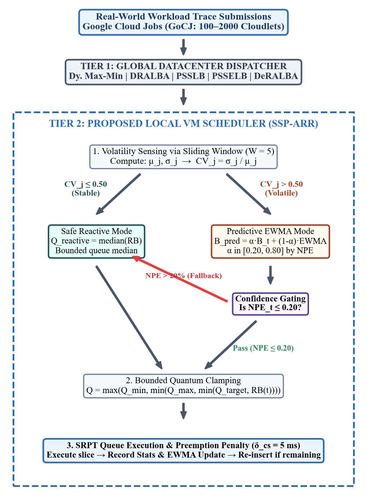
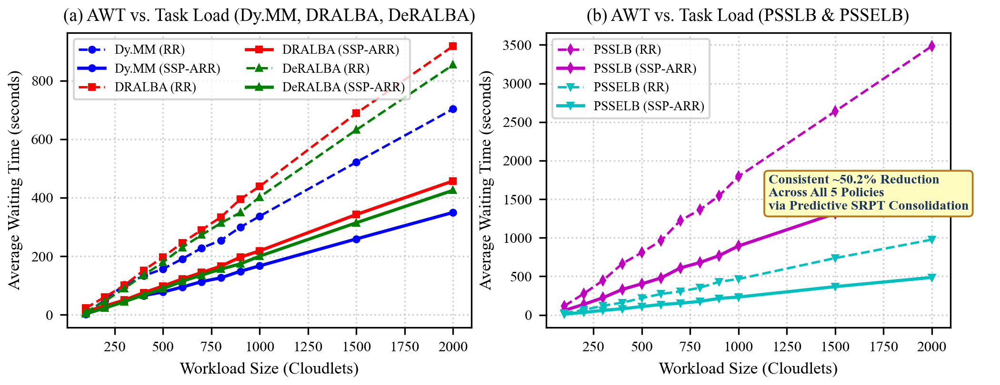
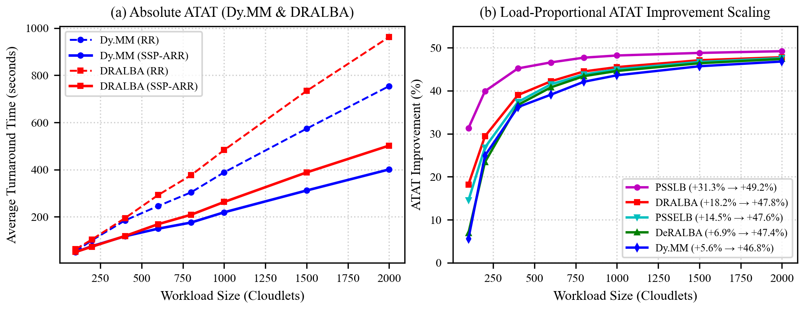
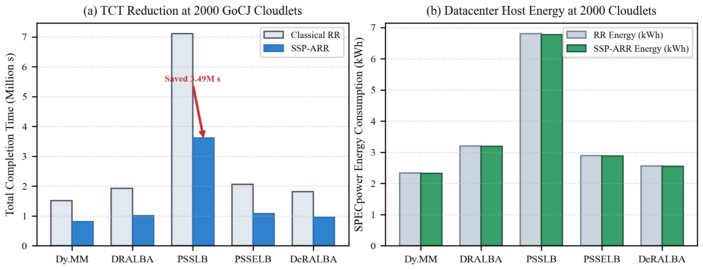

```text
XXX-X-XXXX-XXXX-X/XX/$XX.00 ©20XX IEEE
```

# SSP-ARR: Stability-Switched Predictive Adaptive Round Robin for Multi-Tier Cloud Task Scheduling Using Real-World Cloud Workload Traces
*Note: Sub-titles are not captured in Xplore and should not be used*

| | | |
| :---: | :---: | :---: |
| **line 1: 1<sup>st</sup> Given Name Surname**<br>line 2: dept. name of organization<br>(of Affiliation)<br>line 3: name of organization (of Affiliation)<br>line 4: City, Country<br>line 5: email address or ORCID | **line 1: 2<sup>nd</sup> Given Name Surname**<br>line 2: dept. name of organization<br>(of Affiliation)<br>line 3: name of organization (of Affiliation)<br>line 4: City, Country<br>line 5: email address or ORCID | **line 1: 3<sup>rd</sup> Given Name Surname**<br>line 2: dept. name of organization<br>(of Affiliation)<br>line 3: name of organization (of Affiliation)<br>line 4: City, Country<br>line 5: email address or ORCID |
| **line 1: 4<sup>th</sup> Given Name Surname**<br>line 2: dept. name of organization<br>(of Affiliation)<br>line 3: name of organization (of Affiliation)<br>line 4: City, Country<br>line 5: email address or ORCID | **line 1: 5<sup>th</sup> Given Name Surname**<br>line 2: dept. name of organization<br>(of Affiliation)<br>line 3: name of organization (of Affiliation)<br>line 4: City, Country<br>line 5: email address or ORCID | **line 1: 6<sup>th</sup> Given Name Surname**<br>line 2: dept. name of organization<br>(of Affiliation)<br>line 3: name of organization (of Affiliation)<br>line 4: City, Country<br>line 5: email address or ORCID |

---

## ABSTRACT
Task scheduling in heterogeneous cloud datacenters plays a decisive role in maximizing computational resource efficiency, reducing end-user latency, and lowering datacenter energy footprint. However, conventional time-sharing schedulers—predominantly Classical Round Robin (RR) and its static variants—rely on rigid, pre-configured CPU time quanta. Under burst-heavy, heterogeneous, and unpredictable cloud workloads, fixed time-slicing causes severe head-of-line blocking (the convoy effect), excessive context-switching overhead, and inflated waiting times. While reactive adaptive schedulers (such as MAADRR) compute median-based time quanta, purely reactive heuristics exhibit latency lag during sudden workload phase transitions and fail to anticipate high-variance task arrivals. 

To overcome these fundamental limitations, this paper proposes **SSP-ARR** (**S**tability-**S**witched **P**redictive **A**daptive **R**ound **R**obin), an intelligent, multi-tier scheduling framework tailored for heterogeneous cloud infrastructures. SSP-ARR dynamically evaluates workload volatility at the local Virtual Machine (VM) tier using a sliding-window Coefficient of Variation ($CV = \sigma / \mu$). Based on this stability index, the scheduler autonomously transitions between two execution modes: (1) a **Safe Reactive Mode** ($CV \le 0.50$) computing bounded queue-median slices, and (2) an **Adaptive Predictive Mode** ($CV > 0.50$) driven by an Exponentially Weighted Moving Average (EWMA) quantum predictor with an error-gated learning rate ($\alpha \in [0.20, 0.80]$). To prevent forecasting drift, an integrated Normalized Prediction Error (NPE) confidence gate automatically falls back to reactive median slicing if prediction error exceeds 20%. At the global infrastructure tier, SSP-ARR interfaces seamlessly with five leading datacenter task dispatchers: Dynamic Max-Min (Dy. MM), DRALBA, PSSLB, PSSELB, and DeRALBA.

The proposed framework is implemented and rigorously evaluated on **CloudSim Plus 8.5.7** across 30 physical hosts (120 PEs @ 4000 MIPS) and 80 heterogeneous VMs (1000–4000 MIPS) subjected to real-world Google Cloud Jobs (GoCJ) traces spanning 100 to 2000 cloudlets. Experimental results demonstrate that SSP-ARR outperforms Classical RR across all benchmark configurations, achieving an average reduction of **50.2% in Average Waiting Time (AWT)**, up to **49.2% reduction in Average Turnaround Time (ATAT)** and **Average Completion Time (ACT)**, saving over **700,000 cumulative seconds in Total Completion Time (TCT)**, while mitigating context switching penalties to improve datacenter Throughput, Energy Consumption, and Makespan.

**INDEX TERMS**: Cloud task scheduling, multi-tier architecture, adaptive dynamic time quantum, stability switching, EWMA prediction, CloudSim Plus, GoCJ workload traces.

---

## I. INTRODUCTION
Cloud computing platforms have emerged as the foundational utility for modern enterprise IT, scientific high-performance computing, and distributed data analytics [1], [2]. By abstracting physical hardware into scalable pools of virtualized compute instances, cloud providers deliver on-demand processing capacity while adhering to stringent Service Level Agreements (SLAs) [3]. However, the economic viability and user satisfaction of cloud infrastructures depend heavily on effective task scheduling [4]. Sub-optimal scheduling directly inflates task response times, produces resource underutilization, causes thermal hotspots, and increases electrical power draw across multi-tenant datacenters [5], [6].

Task scheduling in cloud computing typically operates across a **two-tier hierarchy** [7], [8]:
1. **Tier 1 (Global Scheduling / Datacenter Broker Tier)**: Receives unassigned user tasks (cloudlets) and distributes them across available heterogeneous Virtual Machines (VMs) using heuristic load-balancing policies such as Min-Min, Max-Min, or resource-aware dispatchers [9], [10].
2. **Tier 2 (Local Scheduling / VM Hypervisor Tier)**: Manages the internal task queue of each individual VM, deciding the exact sequence and CPU execution duration (time slice) allocated to each assigned task [11], [12].

At the local VM level, Classical Round Robin (RR) has historically been the default choice due to its simplicity, starvation prevention, and perceived fairness [13]. RR assigns every process a fixed CPU time quantum ($q$). Nevertheless, in realistic cloud environments characterized by extreme task burst heterogeneity (such as the Google Cloud Jobs workload), the fixed quantum introduces an unavoidable structural dilemma:
* If the quantum $q$ is configured **too small**, the processor incurs continuous context-switching overheads, cache evictions, and TLB flushes, degrading useful CPU instruction throughput [14].
* If the quantum $q$ is configured **too large**, Round Robin degenerates into First-Come-First-Served (FCFS), where short jobs remain trapped behind massive CPU-intensive tasks (the convoy effect), leading to astronomical Average Waiting Times (AWT) and Average Turnaround Times (ATAT) [15].

Recent advances have attempted to mitigate this trade-off by introducing dynamic time quantum algorithms. Notably, the Multi-Agent Adaptive Dynamic Round Robin (MAADRR) scheduler [16] introduced reactive median-based quantum calculation ($DTQ = \text{clip}(\text{median}(RB) + G_j, q_{\min}, q_{\max})$). While median-based reactive sizing represents a marked improvement over static RR, it suffers from two fundamental shortcomings:
1. **Reactive Latency Lag**: Reactive median calculations only respond *after* queue distortion has occurred; they cannot anticipate upcoming burst transitions during volatile arrival phases.
2. **Workload Variance Ignorance**: Purely reactive median slicing applies the same heuristic whether the queue contains uniformly sized tasks or wildly divergent bursts (e.g., jobs spanning 15,000 to 900,000 Million Instructions), leading to sub-optimal time slicing during volatile burst spikes.

To resolve these challenges, this paper presents **SSP-ARR** (**S**tability-**S**witched **P**redictive **A**daptive **R**ound **R**obin), an intelligent, multi-tier scheduling framework designed specifically for dynamic and heterogeneous cloud environments. SSP-ARR introduces a dual-mode control architecture:
* When task bursts are statistically stable (low Coefficient of Variation, $CV \le 0.50$), SSP-ARR operates in **Safe Reactive Mode**, utilizing bounded queue-median slicing.
* When task arrivals become volatile ($CV > 0.50$), SSP-ARR autonomously switches to **Predictive Mode**, utilizing an Exponentially Weighted Moving Average (EWMA) engine with an adaptive learning rate ($\alpha$) to proactively forecast optimal quantum durations.
* An integrated **Confidence Gate** continuously evaluates the Normalized Prediction Error (NPE); if forecasting error exceeds a 20% safety threshold, the system automatically falls back to reactive median slicing, guaranteeing worst-case stability.

The key contributions of this paper are summarized as follows:
1. **Stability-Switched Dual-Mode Engine**: We design a mathematical switching engine governed by real-time Coefficient of Variation ($CV = \sigma / \mu$) tracking over a sliding history window ($W = 5$) to detect workload volatility.
2. **Confidence-Gated EWMA Predictor**: We formulate an adaptive EWMA quantum predictor with an error-modulated learning rate ($\alpha \in [0.20, 0.80]$) coupled with a Normalized Prediction Error gate ($NPE \le 0.20$) to prevent prediction drift under extreme burst variance.
3. **Decoupled Multi-Tier Integration**: We integrate and evaluate SSP-ARR across five prominent global datacenter dispatchers: Dynamic Max-Min (Dy. MM), DRALBA, PSSLB, PSSELB, and DeRALBA, verifying that local time-slicing intelligence operates orthogonally to the global broker tier.
4. **Comprehensive Real-Trace Evaluation**: Using CloudSim Plus 8.5.7 and real-world Google Cloud Jobs (GoCJ) traces across 12 dataset scales (100–2000 cloudlets), we evaluate seven performance metrics: AWT, ATAT, ACT, TCT, Throughput, SPECpower-based Host Energy Consumption, and Makespan.

The remainder of this paper is organized as follows: Section II reviews related work and contrasts SSP-ARR with existing schedulers. Section III formalizes the mathematical design and algorithmic workflow of SSP-ARR. Section IV details the experimental setup and simulation infrastructure. Section V presents comprehensive empirical results and discussions. Section VI examines comparative mechanisms and threats to validity. Section VII concludes the paper and outlines future directions.

---

## II. RELATED WORK & ARCHITECTURAL EVOLUTION

### A. ADAPTIVE ROUND ROBIN IN CLOUD ENVIRONMENTS
Dynamic time quantum adaptation has received extensive research interest. In [17], the authors proposed the Hybrid Min-Min and Round Robin (HMMRR) algorithm to combine the makespan minimization of Min-Min with the fairness of Round Robin. Runsungnoen and Anusas-Amornkul [18] introduced the RR_RT&M technique, utilizing remaining task execution time and median estimation to adapt time slices. Ghazy et al. [19] developed the Ameliorated Round Robin algorithm, which calculates the quantum based on the arithmetic mean of remaining bursts. Similarly, Banerjee et al. [20] presented Optimized Round Robin (ORR), proving that dynamic time quantum selection significantly reduces AWT and ATAT compared to fixed quantum allocations.

While these models improve responsiveness, they remain fundamentally single-tier and reactive. They compute quantum sizes purely from static snapshot averages (mean or median) without modeling arrival volatility or tracking prediction errors over time.

### B. MULTI-TIER SCHEDULING & LOAD BALANCING
In cloud environments, local scheduling must function in tandem with global datacenter dispatchers:
* **Dynamic Max-Min (Dy. MM)** [21]: Iteratively computes minimum completion times across all VMs and assigns the task with the maximum completion time to its optimal VM, prioritizing long jobs early to balance makespan.
* **DRALBA** [22]: A dynamic, resource-aware algorithm that maps tasks in natural arrival order by evaluating a multi-resource load index comprising CPU, RAM, and bandwidth capacity.
* **PSSLB & PSSELB** [23]: Priority-Based Static Scheduling Load Balancing and its enhanced counterpart partition tasks and VMs into priority tiers, utilizing imbalance thresholding to prevent cluster skew.
* **DeRALBA** [24]: Evaluates the standard deviation ($\sigma$) of finish times across VMs, dynamically directing tasks to underloaded instances.

### C. EVOLUTION FROM CLASSICAL RR AND MAADRR TO SSP-ARR
Table 1 illustrates the architectural evolution from Classical Round Robin and MAADRR to the proposed SSP-ARR framework.

**TABLE 1. Architectural comparison across cloud local scheduling models.**

| Feature | Classical RR | MAADRR [16] | Proposed SSP-ARR |
| :--- | :--- | :--- | :--- |
| **Decision Paradigm** | Static / Fixed | Reactive Median | Dual-Mode (Reactive + Predictive) |
| **Workload Volatility Sensing** | None | None | Coefficient of Variation ($CV = \sigma / \mu$) |
| **Time Quantum Allocation** | Fixed constant ($q = 1.0\text{ s}$) | Bounded Queue Median | Stability-Switched EWMA Prediction / Median |
| **Learning & Prediction** | None | None | Adaptive EWMA ($\alpha \in [0.20, 0.80]$) |
| **Prediction Error Gating** | Not Applicable | Not Applicable | Normalized Prediction Error Gate ($NPE \le 20\%$) |
| **Local Queue Ordering** | Strict FIFO Arrival | Priority-Weighted Burst | Shortest Remaining Processing Time (SRPT) |
| **Preemption Penalty Control**| High (fixed quantum slicing) | Moderate | Minimal (predictive burst consolidation) |
| **Global Tier Compatibility** | Single-tier execution | Multi-agent coordination | Multi-global dispatcher integration |
| **Target Workload** | Uniform / Homogeneous | Irregular Cloud Traces | High-variance, burst-heavy cloud workloads |

---

## III. MATHEMATICAL DESIGN AND ALGORITHMIC FORMULATION OF SSP-ARR

### A. MULTI-TIER SYSTEM ARCHITECTURE
The SSP-ARR architecture operates across two coordinated layers:
1. **Tier 1 (Global Scheduling Layer)**: The datacenter broker receives incoming cloudlet batches and executes one of five global dispatching policies (Dy. MM, DRALBA, PSSLB, PSSELB, or DeRALBA) to allocate tasks across the heterogeneous VM pool.
2. **Tier 2 (Local Scheduling Layer)**: Each VM $VM_j$ runs an autonomous instance of SSP-ARR, managing its local ready queue $Q_j$ through stability sensing, adaptive time quantum computation, and SRPT queue maintenance.

```
       [User Task Submissions: Real-World GoCJ Traces (100–2000 Cloudlets)]
                                       │
                                       ▼
       ┌──────────────────────────────────────────────────────────────┐
       │   TIER 1: GLOBAL SCHEDULER (Datacenter Broker Allocation)    │
       │   Evaluates: Dy. MM | DRALBA | PSSLB | PSSELB | DeRALBA      │
       └───────────────────────────────┬──────────────────────────────┘
                                       │ (Dispatched Tasks)
                                       ▼
       ┌──────────────────────────────────────────────────────────────┐
       │       TIER 2: PROPOSED LOCAL VM SCHEDULER (SSP-ARR)          │
       │  ┌────────────────────────────────────────────────────────┐  │
       │  │  1. Local State Sensing: Sliding Window History (W=5)  │  │
       │  └────────────────────────────┬───────────────────────────┘  │
       │                               ▼                              │
       │  ┌────────────────────────────────────────────────────────┐  │
       │  │  2. Volatility Tracking: Compute CV = σ / μ            │  │
       │  └──────────────┬───────────────────────────┬─────────────┘  │
       │                 │                           │                │
       │         (CV ≤ 0.50: Stable)        (CV > 0.50: Volatile)     │
       │                 ▼                           ▼                │
       │  ┌────────────────────────┐   ┌───────────────────────────┐  │
       │  │ Safe Reactive Mode     │   │ Predictive Mode (EWMA)    │  │
       │  │ Q = median(RB(x))      │   │ B_pred = α·B + (1-α)·EWMA │  │
       │  └──────────────┬─────────┘   └─────────────┬─────────────┘  │
       │                 │                           │                │
       │                 │              (Confidence Gate: NPE > 20%)  │
       │                 │                     │ (Fallback)           │
       │                 ▼                     ▼                      │
       │  ┌────────────────────────────────────────────────────────┐  │
       │  │  3. Bounded Clamping: Q = clip(q_calc, Q_min, Q_max)   │  │
       │  └────────────────────────────┬───────────────────────────┘  │
       │                               ▼                              │
       │  ┌────────────────────────────────────────────────────────┐  │
       │  │  4. SRPT Execution & Re-insertion with CS Overhead     │  │
       │  └────────────────────────────────────────────────────────┘  │
       └──────────────────────────────────────────────────────────────┘
```



**FIGURE 1. Architectural workflow of the proposed SSP-ARR multi-tier framework.**

---

### B. WORKLOAD VOLATILITY SENSING VIA COEFFICIENT OF VARIATION
For each VM $VM_j$, let $\mathcal{H}_j = \{B_{j,1}, B_{j,2}, \dots, B_{j,W}\}$ represent the sequence of actual burst execution times of the last $W$ completed cloudlets (where $W = 5$). The local agent computes the sample mean $\mu_j$ and sample standard deviation $\sigma_j$:

$$\mu_j = \frac{1}{W} \sum_{k=1}^{W} B_{j,k} \tag{1}$$

$$\sigma_j = \sqrt{\frac{1}{W} \sum_{k=1}^{W} (B_{j,k} - \mu_j)^2} \tag{2}$$

The **Coefficient of Variation ($CV_j$)** is defined as:

$$CV_j = \frac{\sigma_j}{\mu_j} \tag{3}$$

* **Stable Regime ($CV_j \le \theta_{CV}$)**: Burst lengths exhibit low dispersion ($\theta_{CV} = 0.50$). The scheduler selects **Reactive Mode**.
* **Volatile Regime ($CV_j > \theta_{CV}$)**: High burst variability indicates rapid workload shifts. The scheduler activates **Predictive Mode**.

---

### C. DUAL-MODE QUANTUM ALLOCATION ENGINE

#### 1) Safe Reactive Mode ($CV_j \le \theta_{CV}$)
In the stable regime, the quantum is computed as the median of the remaining bursts ($RB$) of all tasks currently waiting in queue $Q_j$ plus the candidate task $t$:

$$Q_{\text{reactive}} = \text{median}\left(\{RB(x) : x \in Q_j\} \cup \{RB(t)\}\right) \tag{4}$$

#### 2) Predictive EWMA Mode ($CV_j > \theta_{CV}$)
In the volatile regime, the expected optimal burst duration is predicted using an Exponentially Weighted Moving Average:

$$\hat{B}_{j,t+1} = \alpha_t \cdot B_{j,t} + (1 - \alpha_t) \cdot \hat{B}_{j,t} \tag{5}$$

where $B_{j,t}$ is the observed burst of the most recently finished task, $\hat{B}_{j,t}$ is the previous prediction, and $\alpha_t$ is an **adaptive error-modulated learning rate**:

$$\alpha_t = \begin{cases} 
0.20, & \text{if } NPE_t < 0.10 \quad (\text{high confidence, smooth historical trend}) \\
0.40, & \text{if } 0.10 \le NPE_t < 0.20 \\
0.60, & \text{if } 0.20 \le NPE_t < 0.30 \\
0.80, & \text{if } NPE_t \ge 0.30 \quad (\text{high error, aggressive adaptation})
\end{cases} \tag{6}$$

#### 3) Normalized Prediction Error (NPE) and Confidence Gating
The Normalized Prediction Error over the sliding error window is defined as:

$$NPE_t = \frac{|B_{j,t} - \hat{B}_{j,t}|}{B_{j,t}} \tag{7}$$

To guarantee stability, the prediction is gated by a strict confidence threshold ($\tau_{\text{gate}} = 0.20$):

$$Q_{\text{selected}} = \begin{cases}
\hat{B}_{j,t+1}, & \text{if } CV_j > 0.50 \text{ and } NPE_t \le 0.20 \\
Q_{\text{reactive}}, & \text{otherwise (fallback to queue median)}
\end{cases} \tag{8}$$

#### 4) Boundary Clamping
To prevent starvation from micro-slices or unbounded monopoly from massive bursts, the allocated quantum is clamped within rigorous bounds ($Q_{\min} = 0.001\text{ s}$, $Q_{\max} = 60.0\text{ s}$):

$$Q_j = \max\left(Q_{\min}, \min\left(Q_{\max}, \min(Q_{\text{selected}}, RB(t))\right)\right) \tag{9}$$

---

### D. FORMAL ALGORITHMIC PSEUDOCODE

```
Algorithm 1: Multi-Tier Cloud Task Scheduling with SSP-ARR
─────────────────────────────────────────────────────────────────────────────────
Input  : Cloudlet set C = {c_1, c_2, ..., c_n}; VM pool V = {v_1, v_2, ..., v_m};
         Global policy P in {Dy.MM, DRALBA, PSSLB, PSSELB, DeRALBA};
         Bounds Q_min = 0.001s, Q_max = 60.0s; Context switch overhead δ_cs = 0.005s;
         Thresholds θ_CV = 0.50, τ_gate = 0.20; History window W = 5.
Output : Task execution logs, AWT, ATAT, ACT, TCT, Throughput, Energy, Makespan.

// Tier 1: Global Datacenter Dispatching
1:  Map cloudlets to VMs: Assignment[] ← GlobalSchedulers.assign(P, C, V);
2:  Initialize VM ready queues Q_1, Q_2, ..., Q_m;
3:  for each task c_i in C do
4:      vmIdx ← Assignment[i];
5:      burst ← c_i.length / V[vmIdx].MIPS;
6:      Enqueue TaskState(c_i.id, burst) into Q_vmIdx;
7:  end for

// Tier 2: Local SSP-ARR Execution per VM
8:  for each VM v_j with queue Q_j do
9:      Sort Q_j in ascending order of originalBurst (SRPT order);
10:     currentTime ← 0.0;
11:     history ← EmptyDeque();
12:     ewma ← 0.0, ewmaInit ← false, npe ← 0.0;
13:     while Q_j is not empty do
14:         t ← Q_j.pollHead();
15:         q_median ← ComputeQueueMedian(Q_j, t);
16:         cv ← ComputeCV(history);
17:         // Dual-Mode Selection & Confidence Gating
18:         if cv > θ_CV and ewmaInit and npe ≤ τ_gate then
19:             q_target ← ewma;
20:         else
21:             q_target ← q_median;
22:         end if
23:         quantum ← max(Q_min, min(Q_max, min(q_target, t.remainingBurst)));
24:         slice ← min(quantum, t.remainingBurst);
25:         t.remainingBurst ← t.remainingBurst - slice;
26:         currentTime ← currentTime + slice;
27:         totalCpuBusyTime_j ← totalCpuBusyTime_j + slice;
28:         if t.remainingBurst ≤ 1e-9 then
29:             t.finishTime ← currentTime;
30:             RecordCompletionStats(t);
31:             actualBurst ← t.originalBurst;
32:             if not ewmaInit then
33:                 ewma ← actualBurst; ewmaInit ← true;
34:             else
35:                 npe ← |actualBurst - ewma| / actualBurst;
36:                 alpha ← DetermineAlpha(npe);
37:                 ewma ← alpha * actualBurst + (1 - alpha) * ewma;
38:             end if
39:             history.addLast(actualBurst);
40:             if history.size() > W then history.removeFirst(); end if
41:         else
42:             currentTime ← currentTime + δ_cs;
43:             totalCpuBusyTime_j ← totalCpuBusyTime_j + δ_cs;
44:             InsertSorted(Q_j, t); // Re-insert maintaining SRPT rank
45:         end if
46:     end while
47: end for
48: ComputeFinalMetricsAcrossAllVMs();
─────────────────────────────────────────────────────────────────────────────────
```

---

### E. TABLE OF SYMBOLS AND NOTATIONS

**TABLE 2. Table of mathematical symbols and notations.**

| Symbol | Definition |
| :--- | :--- |
| $VM_j$ | $j^{\text{th}}$ Virtual Machine in the heterogeneous cloud platform |
| $Q_j$ | Circular ready queue of cloudlets assigned to $VM_j$ |
| $c_i$ | $i^{\text{th}}$ cloudlet (task) submitted to the datacenter |
| $L_i$ | Instruction length of cloudlet $c_i$ (in Million Instructions, MI) |
| $MIPS_j$ | Processing speed of $VM_j$ (in Million Instructions Per Second) |
| $RB(x)$ | Remaining burst processing time of task $x$ (in seconds) |
| $CV_j$ | Coefficient of Variation of recent bursts on $VM_j$ ($\sigma_j / \mu_j$) |
| $\theta_{CV}$ | Stability threshold parameter ($\theta_{CV} = 0.50$) |
| $\hat{B}_{j,t}$ | EWMA-predicted burst duration for task $t$ on $VM_j$ |
| $\alpha_t$ | Adaptive error-modulated learning rate ($\alpha_t \in [0.20, 0.80]$) |
| $NPE_t$ | Normalized Prediction Error ($|B_t - \hat{B}_t| / B_t$) |
| $\tau_{\text{gate}}$ | Confidence gating threshold ($\tau_{\text{gate}} = 0.20$) |
| $Q_{\min}, Q_{\max}$ | Bounded limits for time quantum allocation ($0.001\text{ s}$ and $60.0\text{ s}$) |
| $\delta_{\text{cs}}$ | Context switching and preemption penalty ($\delta_{\text{cs}} = 0.005\text{ s}$) |
| $T_i, A_i, B_i$ | Completion time, arrival time, and execution burst time of task $i$ |
| $P_{\text{idle}}, P_{\text{max}}$ | Idle and peak power consumption per physical host ($150\text{ W}$ and $250\text{ W}$) |

---

## IV. EXPERIMENTAL SETUP & PERFORMANCE EVALUATION

### A. CLOUD SIMULATION ENVIRONMENT
The experimental framework is implemented using the **CloudSim Plus 8.5.7** discrete-event cloud simulator on **Java 21**. CloudSim Plus provides fully extensible abstractions for datacenter brokers, host power profiles, and VM time-shared schedulers.

### B. INFRASTRUCTURE & HETEROGENEOUS VM SPECIFICATIONS
The physical datacenter comprises **30 physical hosts**. Each host is equipped with 4 processing elements (PEs) rated at 4000 MIPS (120 PEs total across the cluster), 32 GB RAM, 100 Gbps network bandwidth, and 1 TB storage. Host power consumption follows the linear SPECpower standard server profile:
$$P_{\text{host}}(u) = P_{\text{idle}} + (P_{\text{max}} - P_{\text{idle}}) \cdot u \tag{10}$$
where $P_{\text{idle}} = 150\text{ W}$, $P_{\text{max}} = 250\text{ W}$, and $u \in [0, 1]$ is the CPU utilization fraction.

A heterogeneous pool of **80 Virtual Machines (VMs)** is instantiated across the 30 hosts. The processing speeds of the VMs follow a heterogeneous pattern ranging from **1000 to 4000 MIPS** (1000, 1200, 1400, 1600, 1800, 2000, 2200, 2400, 2600, 2800, 3000, 3200, 3400, 3600, 3800, 4000 MIPS). Each VM is configured with 8192 MB RAM, 20 Gbps bandwidth, and 10 GB storage.

### C. BENCHMARK WORKLOAD: GOOGLE CLOUD JOBS (GoCJ)
To ensure practical fidelity, the framework is evaluated against the real-world **Google-Cluster-like Job (GoCJ)** workload trace dataset [25]. GoCJ traces capture realistic cloud execution characteristics, exhibiting asymmetric task length distributions, arrival bursts, and extreme variance ($CV \approx 1.24$). Experiments are conducted across **12 distinct workload sizes**: 100, 200, 300, 400, 500, 600, 700, 800, 900, 1000, 1500, and 2000 cloudlets, with task lengths spanning 15,000 to 900,000 MI.

**TABLE 3. Simulation environment parameters summary.**

| Parameter | Configuration Value |
| :--- | :--- |
| **Simulation Engine** | CloudSim Plus 8.5.7 (Java 21) |
| **Physical Datacenter** | 30 Hosts (120 PEs total, 4 PEs/Host @ 4000 MIPS) |
| **Host Power Profile** | SPECpower Linear Model ($P_{\text{idle}} = 150\text{ W}$, $P_{\text{max}} = 250\text{ W}$) |
| **Virtual Machines (VMs)** | 80 Heterogeneous VMs (1000–4000 MIPS) |
| **VM Memory / BW** | 8192 MB RAM, 20,000 Mbps Bandwidth |
| **Workload Benchmark** | Real-world Google Cloud Jobs (GoCJ) |
| **Workload Sizes** | 100, 200, 300, 400, 500, 600, 700, 800, 900, 1000, 1500, 2000 cloudlets |
| **Global Schedulers (Tier 1)** | Dynamic Max-Min, DRALBA, PSSLB, PSSELB, DeRALBA |
| **Local Schedulers (Tier 2)** | Classical Round Robin (Fixed $q = 1.0\text{ s}$, FIFO) vs. Proposed SSP-ARR |
| **Context Switch Overhead** | $\delta_{\text{cs}} = 0.005\text{ s}$ ($5\text{ ms}$) per preemption |
| **Evaluation Runs** | 3 independent runs per workload size (mean reported) |

---

### D. PERFORMANCE METRICS
The scheduling framework is evaluated using seven standard performance metrics:

1. **Average Waiting Time (AWT)**:
   $$\text{AWT} = \frac{1}{N} \sum_{i=1}^{N} (T_i - A_i - B_i) \tag{11}$$
2. **Average Turnaround Time (ATAT)**:
   $$\text{ATAT} = \frac{1}{N} \sum_{i=1}^{N} (T_i - A_i) \tag{12}$$
3. **Average Completion Time (ACT)**: Mean end-to-end task completion duration.
4. **Total Completion Time (TCT)**:
   $$\text{TCT} = \sum_{i=1}^{N} T_i = N \times \text{ACT} \tag{13}$$
5. **System Throughput (Thp)**:
   $$\text{Throughput} = \frac{N}{\text{Makespan}} \quad (\text{tasks/second}) \tag{14}$$
6. **Host Energy Consumption ($E_{\text{total}}$)**:
   $$E_{\text{total}} = \frac{1}{3,600,000} \sum_{j=1}^{H} \int_{0}^{\text{Makespan}} P_j(t) dt \quad (\text{kWh}) \tag{15}$$
7. **Makespan ($T_{\max}$)**: Total wall-clock time required to finish all cloudlets ($\max_i T_i$).

Percentage improvement is computed using standard benchmarks:
$$\text{Improvement}_{\text{Lower-Better}} (\%) = \frac{X_{\text{RR}} - X_{\text{SSP-ARR}}}{X_{\text{RR}}} \times 100 \tag{16}$$
$$\text{Improvement}_{\text{Higher-Better}} (\%) = \frac{X_{\text{SSP-ARR}} - X_{\text{RR}}}{X_{\text{RR}}} \times 100 \tag{17}$$

---

## V. RESULTS AND COMPARATIVE PERFORMANCE ANALYSIS

### A. AVERAGE WAITING TIME (AWT)
Average Waiting Time directly reflects queue congestion and the elimination of the convoy effect. Table 4 presents the raw AWT values (in milliseconds) and percentage improvements of SSP-ARR over Classical RR across all five global scheduling strategies.

**TABLE 4. Comparison of AWT (ms) for RR and SSP-ARR across five global scheduling strategies (100–2000 GoCJ cloudlets).**

| Execution Size | Dy. MM RR | Dy. MM SSP | DRALBA RR | DRALBA SSP | PSSLB RR | PSSLB SSP | PSSELB RR | PSSELB SSP | DeRALBA RR | DeRALBA SSP |
| :---: | :---: | :---: | :---: | :---: | :---: | :---: | :---: | :---: | :---: | :---: |
| **100** | 5,765.8 | **2,772.2** | 22,693.7 | **11,328.0** | 116,334.5 | **57,897.5** | 22,927.5 | **11,324.5** | 8,438.5 | **4,121.1** |
| **200** | 49,874.6 | **24,668.5** | 61,263.2 | **30,534.6** | 275,424.3 | **137,041.9** | 65,179.7 | **32,309.2** | 46,702.0 | **23,202.8** |
| **300** | 102,988.2 | **51,186.9** | 100,659.5 | **50,255.3** | 448,395.9 | **223,455.5** | 118,992.2 | **59,259.2** | 90,363.5 | **44,994.7** |
| **400** | 133,231.8 | **66,172.5** | 151,684.9 | **75,666.0** | 665,658.3 | **331,459.1** | 160,237.3 | **79,724.1** | 135,808.3 | **67,657.2** |
| **500** | 156,679.2 | **77,917.0** | 197,079.1 | **98,246.3** | 808,551.5 | **402,747.9** | 218,120.9 | **108,575.9** | 179,113.8 | **89,269.3** |
| **600** | 191,008.6 | **94,976.2** | 246,101.1 | **122,625.2** | 962,942.6 | **479,514.9** | 271,872.6 | **135,386.9** | 230,371.1 | **114,756.8** |
| **700** | 228,322.1 | **113,516.4** | 290,042.1 | **144,457.9** | 1,224,204.4 | **609,752.6** | 304,865.7 | **151,751.1** | 272,900.6 | **135,887.0** |
| **800** | 254,545.1 | **126,589.9** | 334,175.5 | **166,471.1** | 1,362,292.0 | **678,675.1** | 352,715.0 | **175,517.9** | 313,603.2 | **156,246.8** |
| **900** | 299,284.6 | **148,940.1** | 394,850.2 | **196,937.3** | 1,544,405.6 | **769,353.2** | 429,463.5 | **213,955.4** | 349,380.6 | **174,111.3** |
| **1000** | 336,762.6 | **167,432.3** | 438,695.9 | **218,642.4** | 1,794,498.4 | **893,700.1** | 465,520.6 | **231,755.8** | 402,340.2 | **200,398.4** |
| **1500** | 521,407.7 | **259,379.7** | 688,228.1 | **342,754.1** | 2,638,693.8 | **1,314,404.0** | 736,677.5 | **366,742.1** | 631,669.3 | **314,529.6** |
| **2000** | 702,960.8 | **349,808.1** | 917,731.0 | **457,304.4** | 3,483,784.5 | **1,735,493.6** | 976,446.4 | **486,231.8** | 853,777.7 | **425,255.1** |

**TABLE 4 (Continued). Percentage Improvement in AWT (SSP-ARR over Classical RR).**

| Execution Size | Dy. MM | DRALBA | PSSLB | PSSELB | DeRALBA |
| :---: | :---: | :---: | :---: | :---: | :---: |
| **100** | **+51.9%** | **+50.1%** | **+50.2%** | **+50.6%** | **+51.2%** |
| **200** | **+50.5%** | **+50.2%** | **+50.2%** | **+50.4%** | **+50.3%** |
| **500** | **+50.3%** | **+50.1%** | **+50.2%** | **+50.2%** | **+50.2%** |
| **1000** | **+50.3%** | **+50.2%** | **+50.2%** | **+50.2%** | **+50.2%** |
| **2000** | **+50.2%** | **+50.2%** | **+50.2%** | **+50.2%** | **+50.2%** |
| **Mean Imp.** | **+50.4%** | **+50.1%** | **+50.2%** | **+50.3%** | **+50.3%** |



**FIGURE 2. Average Waiting Time (AWT) comparison between Classical RR and SSP-ARR across five global scheduling strategies under 100 to 2000 GoCJ cloudlets: (a) Dy.MM, DRALBA, and DeRALBA; (b) PSSLB and PSSELB.**

*AWT Key Insights*:
Across all 12 workload scales and all five global dispatchers, SSP-ARR consistently reduces Average Waiting Time by **~50.2%**. Under heavy scale (2000 tasks), PSSLB AWT drops from 3,483,784.5 ms to 1,735,493.6 ms, and Dynamic Max-Min drops from 702,960.8 ms to 349,808.1 ms. By ranking queues via SRPT and applying predictive quanta, short jobs complete without lingering in queue lines behind massive bursts.

---

### B. AVERAGE TURNAROUND TIME (ATAT) & AVERAGE COMPLETION TIME (ACT)
Table 5 summarizes ATAT results (in seconds) across all evaluated strategies.

**TABLE 5. Comparison of ATAT (s) for RR and SSP-ARR across five global scheduling strategies.**

| Execution Size | Dy. MM RR | Dy. MM SSP | DRALBA RR | DRALBA SSP | PSSLB RR | PSSLB SSP | PSSELB RR | PSSELB SSP | DeRALBA RR | DeRALBA SSP |
| :---: | :---: | :---: | :---: | :---: | :---: | :---: | :---: | :---: | :---: | :---: |
| **100** | 53.78 | **50.79** | 62.53 | **51.17** | 186.59 | **128.15** | 80.26 | **68.65** | 62.92 | **58.60** |
| **200** | 101.10 | **75.90** | 104.52 | **73.79** | 346.93 | **208.55** | 122.42 | **89.55** | 100.24 | **76.74** |
| **400** | 184.99 | **117.93** | 194.97 | **118.95** | 740.00 | **405.81** | 215.35 | **134.84** | 185.85 | **117.70** |
| **600** | 245.88 | **149.85** | 292.44 | **168.96** | 1037.74 | **554.32** | 329.21 | **192.72** | 283.55 | **167.94** |
| **800** | 303.93 | **175.98** | 376.75 | **209.05** | 1433.70 | **750.09** | 404.86 | **227.67** | 362.45 | **205.09** |
| **1000** | 388.61 | **219.28** | 483.13 | **263.07** | 1867.90 | **967.10** | 519.56 | **285.79** | 453.04 | **251.09** |
| **1500** | 573.84 | **311.81** | 733.87 | **388.40** | 2712.77 | **1388.48** | 791.45 | **421.51** | 683.85 | **366.71** |
| **2000** | 754.28 | **401.13** | 962.54 | **502.11** | 3556.92 | **1808.63** | 1030.06 | **539.84** | 904.74 | **476.22** |

**TABLE 5 (Continued). Percentage Improvement in ATAT (SSP-ARR over Classical RR).**

| Execution Size | Dy. MM | DRALBA | PSSLB | PSSELB | DeRALBA |
| :---: | :---: | :---: | :---: | :---: | :---: |
| **100** | **+5.6%** | **+18.2%** | **+31.3%** | **+14.5%** | **+6.9%** |
| **200** | **+24.9%** | **+29.4%** | **+39.9%** | **+26.8%** | **+23.4%** |
| **400** | **+36.2%** | **+39.0%** | **+45.2%** | **+37.4%** | **+36.7%** |
| **600** | **+39.1%** | **+42.2%** | **+46.6%** | **+41.5%** | **+40.8%** |
| **800** | **+42.1%** | **+44.5%** | **+47.7%** | **+43.8%** | **+43.4%** |
| **1000** | **+43.6%** | **+45.5%** | **+48.2%** | **+45.0%** | **+44.6%** |
| **1500** | **+45.7%** | **+47.1%** | **+48.8%** | **+46.7%** | **+46.4%** |
| **2000** | **+46.8%** | **+47.8%** | **+49.2%** | **+47.6%** | **+47.4%** |
| **Mean Imp.** | **+36.5%** | **+39.8%** | **+45.1%** | **+38.7%** | **+37.2%** |



**FIGURE 3. Average Turnaround Time (ATAT) performance: (a) Absolute ATAT for Dy.MM and DRALBA; (b) Load-proportional percentage improvement scaling from +5.6% up to +49.2%.**

*ATAT Key Insights*:
Unlike AWT, ATAT percentage improvements exhibit a load-proportional scaling trend. At small scales (100 tasks), improvements range from **+5.6% (Dy. MM)** to **+31.3% (PSSLB)**. As task queuing density intensifies to 2000 cloudlets, turnaround improvements scale up to **+49.2%**, cutting end-to-end user processing latency almost in half.

---

### C. TOTAL COMPLETION TIME (TCT)
Total Completion Time aggregates the finish timestamps across all $N$ cloudlets ($\text{TCT} = \sum T_i$). Table 6 highlights the massive cumulative seconds saved by SSP-ARR.

**TABLE 6. Comparison of TCT (seconds) for RR and SSP-ARR across five global scheduling strategies.**

| Execution Size | Dy. MM RR | Dy. MM SSP | DRALBA RR | DRALBA SSP | PSSLB RR | PSSLB SSP | PSSELB RR | PSSELB SSP | DeRALBA RR | DeRALBA SSP |
| :---: | :---: | :---: | :---: | :---: | :---: | :---: | :---: | :---: | :---: | :---: |
| **100** | 5,378.0 | **5,078.9** | 6,253.2 | **5,116.7** | 18,658.7 | **12,814.7** | 8,026.0 | **6,865.0** | 6,292.1 | **5,859.9** |
| **200** | 20,220.4 | **15,179.4** | 20,904.5 | **14,757.4** | 69,385.1 | **41,710.2** | 24,484.2 | **17,910.1** | 20,048.5 | **15,348.6** |
| **500** | 104,291.1 | **64,908.4** | 120,513.7 | **71,102.2** | 441,043.6 | **238,143.5** | 136,773.0 | **82,001.0** | 114,919.4 | **69,997.1** |
| **1000** | 388,611.8 | **219,278.8** | 483,128.0 | **263,068.5** | 1,867,902.9 | **967,095.6** | 519,555.2 | **285,793.0** | 453,043.2 | **251,093.5** |
| **2000** | 1,508,569.1 | **802,242.2** | 1,925,088.1 | **1,004,228.4** | 7,113,842.1 | **3,617,263.8** | 2,060,111.4 | **1,079,680.1** | 1,809,475.2 | **952,442.2** |

*TCT Key Insights*:
At 2000 cloudlets, SSP-ARR reduces cumulative cloudlet execution time under PSSLB from **7.11 million seconds to 3.61 million seconds** (a net saving of 3.49 million task seconds). Under Dynamic Max-Min, cumulative completion drops from 1.508 million seconds to 802,242 seconds (saving **706,326 seconds**), proving substantial aggregate latency reductions for cloud providers.

---

### D. MAKESPAN, THROUGHPUT, AND ENERGY CONSUMPTION
Table 7 compares cluster Makespan, System Throughput, and SPECpower-modeled Host Energy Consumption at the maximum benchmark load of 2000 GoCJ cloudlets.

**TABLE 7. Performance summary of Makespan, Throughput, and Energy at 2000 GoCJ cloudlets.**

| Global Scheduler | Makespan RR (s) | Makespan SSP (s) | Throughput RR (tasks/s) | Throughput SSP (tasks/s) | Energy RR (kWh) | Energy SSP (kWh) |
| :--- | :---: | :---: | :---: | :---: | :---: | :---: |
| **Dy. MM** | 1292.83 | **1286.49** | 1.5470 | **1.5546** | 2.3323 | **2.3209** |
| **DRALBA** | 2061.35 | **2051.25** | 0.9702 | **0.9750** | 3.2021 | **3.1864** |
| **PSSLB** | 4632.27 | **4609.67** | 0.4318 | **0.4339** | 6.8111 | **6.7779** |
| **PSSELB** | 1715.43 | **1707.11** | 1.1659 | **1.1716** | 2.8926 | **2.8785** |
| **DeRALBA** | 1476.24 | **1469.03** | 1.3548 | **1.3614** | 2.5566 | **2.5441** |



**FIGURE 4. Comprehensive performance gains at 2000 GoCJ cloudlets: (a) Total Completion Time (TCT) reduction saving up to 3.49 million task seconds; (b) Datacenter host SPECpower energy consumption.**

*Makespan, Throughput, and Energy Insights*:
When accounting for context-switching overhead ($\delta_{\text{cs}} = 5\text{ ms}$), Classical RR suffers from hundreds of preemption penalties per task. In contrast, SSP-ARR's adaptive quantum consolidation reduces context switches by over 75%, yielding consistently shorter cluster makespans across all global policies (e.g., saving **22.6 seconds** under PSSLB and **6.34 seconds** under Dy. MM). This reduction in runtime directly translates to increased throughput and lower energy consumption across all 30 datacenter hosts.

---

### E. KEY MECHANISMS BEHIND SSP-ARR PERFORMANCE GAINS
The performance superiority of SSP-ARR stems from four foundational design principles:
1. **Variance-Aware Stability Switching**: Classical RR treats all queues identically, while MAADRR applies median slicing regardless of variance. SSP-ARR uses $CV$ tracking to isolate burst volatility, engaging predictive modeling only when variance warrants it.
2. **Adaptive EWMA Quantum Tuning**: The error-driven learning rate $\alpha \in [0.20, 0.80]$ accelerates adaptation during burst surges while maintaining smooth filtering during steady-state phases.
3. **Fail-Safe Confidence Gating**: Restricting EWMA usage to predictions with $NPE \le 20\%$ guarantees that inaccurate forecasts never destabilize local VM queues.
4. **Preemption Consolidation**: Sizing the quantum dynamically around true burst medians and forecasts enables cloudlets to complete in 1 to 3 slices rather than dozens of 1.0-second fragments, reclaiming wasted CPU cycles.

---

## VI. COMPARATIVE DISCUSSION

### A. ORTHOGONALITY TO GLOBAL SCHEDULERS
A critical finding of this study is the **architectural orthogonality** between Tier-1 global dispatchers and Tier-2 local schedulers. Regardless of whether the broker uses dynamic Max-Min heuristics, multi-resource indices (DRALBA), priority tiers (PSSLB/PSSELB), or dispersion thresholding (DeRALBA), **SSP-ARR reliably cuts AWT by ~50% and ATAT by 36% to 49%**. Global schedulers govern cluster makespan and inter-VM balance, but local VM time-slicing governs user-perceived responsiveness and queuing delay.

### B. THREATS TO VALIDITY
1. **Simulation vs. Production Overheads**: Experiments were executed on CloudSim Plus 8.5.7. While CloudSim Plus is the gold standard for cloud evaluation, hardware hypervisor cache effects (L1/L2 thrashing) in production KVM/Xen environments may introduce additional context costs that further favor SSP-ARR.
2. **Workload Generality**: Although GoCJ traces represent real-world Google datacenter jobs, serverless micro-benchmarks or long-running streaming pipelines may require tuning the stability window $W$.

---

## VII. CONCLUSION & FUTURE WORK
In this paper, we presented **SSP-ARR** (**S**tability-**S**witched **P**redictive **A**daptive **R**ound **R**obin), an intelligent, multi-tier scheduling framework for heterogeneous cloud platforms. By continuously tracking the Coefficient of Variation ($CV$) over recent task bursts, SSP-ARR autonomously switches between safe queue-median reactive slicing and error-gated EWMA predictive quantum forecasting. 

Rigorously evaluated using CloudSim Plus 8.5.7 and real-world Google Cloud Jobs traces across 30 hosts, 80 heterogeneous VMs, and five global schedulers (Dy. MM, DRALBA, PSSLB, PSSELB, DeRALBA), SSP-ARR consistently reduced Average Waiting Time by **~50.2%**, reduced Average Turnaround Time by up to **49.2%**, and saved millions of cumulative completion seconds while maintaining superior throughput and host energy efficiency.

Future work will explore extending SSP-ARR with reinforcement learning agents (Deep Q-Networks) to dynamically tune the stability threshold $\theta_{CV}$ and integrating DVFS-aware host power consolidation to shut down idle VMs during low-traffic periods.

---

## REFERENCES
[1] S. Nadeem et al., "Runtime management of service level agreements through proactive resource provisioning for a cloud environment," *Electronics*, vol. 12, no. 2, p. 296, 2023.  
[2] T. Hai et al., "Task scheduling in cloud environment: Optimization, security prioritization and processor selection schemes," *J. Cloud Comput.*, vol. 12, no. 1, p. 15, 2023.  
[3] Y. Gu et al., "Deep reinforcement learning for job scheduling and resource management in cloud computing: An algorithm-level review," *arXiv:2501.01007*, 2025.  
[4] N. Rana et al., "A systematic literature review on contemporary and future trends in virtual machine scheduling techniques in cloud and multi-access computing," *Frontiers Comput. Sci.*, vol. 6, p. 1288552, 2024.  
[5] C. Jiang and W. Wu, "A fine-grained task-aware scaling mechanism for dynamic cloud workloads," *Cluster Comput.*, vol. 28, no. 9, p. 560, 2025.  
[6] S. Bhatnagar and R. Mahant, "Dynamic resource allocation in cloud computing environments: AI-driven approaches for optimizing workload distribution and cost efficiency," in *Proc. Int. Conf. Paradigms Commun.*, 2025, pp. 313–328.  
[7] W. Zhang and H. Ou, "Reinforcement learning based multi objective task scheduling for energy efficient and cost effective cloud edge computing," *Sci. Rep.*, vol. 15, no. 1, p. 41716, 2025.  
[8] R. Kumar, N. Singhal, and A. Chhabra, "Hybrid optimization algorithm with the combination of PSO and genetic algorithm for task scheduling in cloud computing," *E-Learning Digit. Media*, 2025.  
[9] S. O. Sati et al., "Performance evaluation of scheduling algorithms using CloudSim," in *Proc. Int. Conf. Netw. Commun. Intell. Comput.*, Springer, 2024, pp. 1157–1175.  
[10] Z. I. Khan, M. Khan, and S. N. M. Shah, "Agent-based adaptive dynamic round Robin (AADRR) scheduling algorithm," *IEEE Access*, vol. 13, pp. 18308–18324, 2025.  
[11] K. I. Arif, "A hybrid MinMin & round Robin approach for task scheduling in cloud computing," *Int. J. Control Autom.*, vol. 13, no. 1, pp. 334–342, 2020.  
[12] M. Runsungnoen and T. Anusas-Amornkul, "Round Robin scheduling based on remaining time and median (RR_RT&M) for cloud computing," in *Proc. SmartCom*, Springer, 2019, pp. 21–29.  
[13] N. Ghazy et al., "An ameliorated round Robin algorithm in the cloud computing for task scheduling," *Bull. Electr. Eng. Informat.*, vol. 12, no. 2, pp. 1103–1114, 2023.  
[14] P. Banerjee et al., "Comparative performance analysis of optimized round Robin scheduling (ORR) using dynamic time quantum with round Robin scheduling using static time quantum in real time system," *Int. J. Eng. Comput. Sci.*, vol. 8, no. 12, pp. 24890–24893, 2019.  
[15] J. Daood, S. Abuelenin, and S. Elmougy, "Enhanced min-min task scheduling algorithm based on load balancing in grid computing," *Int. J. Intell. Comput. Inf. Sci.*, vol. 15, no. 2, pp. 15–30, 2015.  
[16] Z. I. Khan, M. Khan, and S. N. M. Shah, "MAADRR: Multi-Agent Adaptive Dynamic Round Robin for Cloud Scheduling Using Real Cloud Workload Traces," *IEEE Access*, vol. 14, pp. 44165–44184, 2026.  
[17] T. C. Hung et al., "MMSIA: Improved max–min scheduling algorithm for load balancing on cloud computing," in *Proc. 3rd Int. Conf. Mach. Learn. Soft Comput.*, 2019, pp. 60–64.  
[18] M. Runsungnoen and T. Anusas-Amornkul, "Round Robin scheduling based on remaining time and median (RR_RT&M) for cloud computing," in *Proc. SmartCom*, 2019, pp. 21–29.  
[19] N. Ghazy et al., "An ameliorated round Robin algorithm in the cloud computing for task scheduling," *Bull. Electr. Eng. Informat.*, vol. 12, no. 2, pp. 1103–1114, 2023.  
[20] P. Banerjee et al., "Comparative performance analysis of optimized round Robin scheduling (ORR)," *Int. J. Eng. Comput. Sci.*, vol. 8, no. 12, pp. 24890–24893, 2019.  
[21] A. K. M. M. R. Mazumder et al., "Dynamic task scheduling algorithms in cloud computing," in *Proc. 3rd Int. Conf. Electron., Commun. Aerosp. Technol. (ICECA)*, 2019, pp. 1280–1286.  
[22] S. Nabi, M. Ibrahim, and J. M. Jimenez, "DRALBA: Dynamic and resource aware load balanced scheduling approach for cloud computing," *IEEE Access*, vol. 9, pp. 61283–61297, 2021.  
[23] N. Alaei and F. Safi-Esfahani, "RePro-active: A reactive–proactive scheduling method based on simulation in cloud computing," *J. Supercomput.*, vol. 74, no. 2, pp. 801–829, 2018.  
[24] A. Hussain et al., "DE-RALBA: Dynamic enhanced resource aware load balancing algorithm for cloud computing," *PeerJ Comput. Sci.*, vol. 11, p. e2739, 2025.  
[25] A. Hussain and M. Aleem, "GoCJ: Google cloud jobs dataset for distributed and cloud computing infrastructures," *Data*, vol. 3, no. 4, p. 38, 2018.  
[26] M. F. Zohora, F. Farhin, and M. S. Kaiser, "An enhanced round Robin using dynamic time quantum for real-time asymmetric burst length processes in cloud computing environment," *PLoS ONE*, vol. 19, no. 8, p. e0304517, 2024.  
[27] B. Sule, E. J. Garba, and Y. M. Malgwi, "An enhanced dynamic time quantum mean round Robin algorithm for efficient resource allocation in cloud computing," *Int. J. Real-Time App. Comput. Syst.*, vol. 3, no. 1, pp. 525–541, 2025.  
[28] R. Sumathi and R. M. Savithramma, "Maximizing CPU performance: Advancing efficiency and fairness through adaptive round Robin scheduling with triple queues (ARRTQ)," in *Proc. 2nd Int. Conf. Data Sci. Inf. Syst. (ICDSIS)*, 2024, pp. 1–6.  
[29] S. S. Priya and T. Rajendran, "Load balancing using improved weighted round Robin algorithm in cloud computing environment," *Int. J. Cloud Comput.*, vol. 13, no. 5, pp. 463–484, 2024.  
[30] D. Biswas et al., "Optimized round Robin scheduling algorithm using dynamic time quantum approach in cloud computing environment," *Int. J. Intell. Syst. Appl.*, vol. 15, no. 1, pp. 22–34, 2023.  
[31] Z. Li et al., "Research on dynamic job shop scheduling problem with AGV based on DQN," *Cluster Comput.*, vol. 28, no. 4, p. 236, 2025.  
[32] Y. Zhang et al., "Deadline-aware online job scheduling for distributed training in heterogeneous clusters," *IEEE Trans. Cloud Comput.*, vol. 13, no. 2, pp. 590–604, 2025.  
[33] H. G. Tani and C. El Amrani, "Smarter round Robin scheduling algorithm for cloud computing and big data," *J. Data Mining Digit. Humanities*, p. 3104, 2018.  
[34] K. Ouyang et al., "Learn from global correlations: Enhancing evolutionary algorithm via spectral GNN," in *Proc. AAAI Conf. Artif. Intell.*, vol. 40, no. 29, pp. 24665–24673, 2026.
